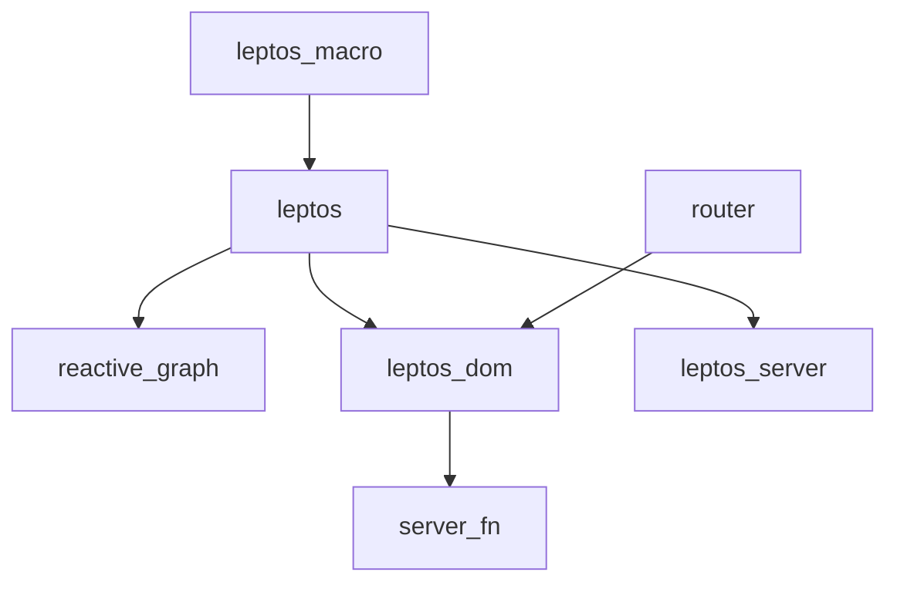

# leptos-rs/leptos

> Full-stack Rust web framework with fine-grained reactivity, for those who want interfaces without a virtual DOM.

## The problem
Writing front and back end in Rust without maintaining a separate API or paying the cost of a virtual DOM.

## What it actually does
Reactive signals update DOM nodes directly. The framework covers browser rendering, server rendering and hydration, with HTML streaming. Server functions are called like local functions. A router and a build tool (`cargo-leptos`) complete the set.

## How it is wired
Diagram based on the supplied one, reduced.



## Trying it
```bash
cargo install cargo-leptos --locked
cargo leptos new --git https://github.com/leptos-rs/start-axum
cd [your project name]
cargo leptos watch
```
Then open http://localhost:3000/.

## Cost and gotchas
Free (MIT). You need a Rust toolchain and the wasm target. On wasm, `getrandom` requires the `js` feature to be enabled. The official book is still being written.

## What it is not
Not a data or AI framework. Generic rendering for native GUIs has been set aside for version 0.7. Bugs exist, the author says so.

## Alternatives
- Yew: the most widely used, but based on a virtual DOM.
- Dioxus: better experience for desktop applications.
- Sycamore: similar in spirit, smaller community.

## For you
Watch: relevant only if you build web interfaces in Rust; for data dashboards, Python remains more direct.
