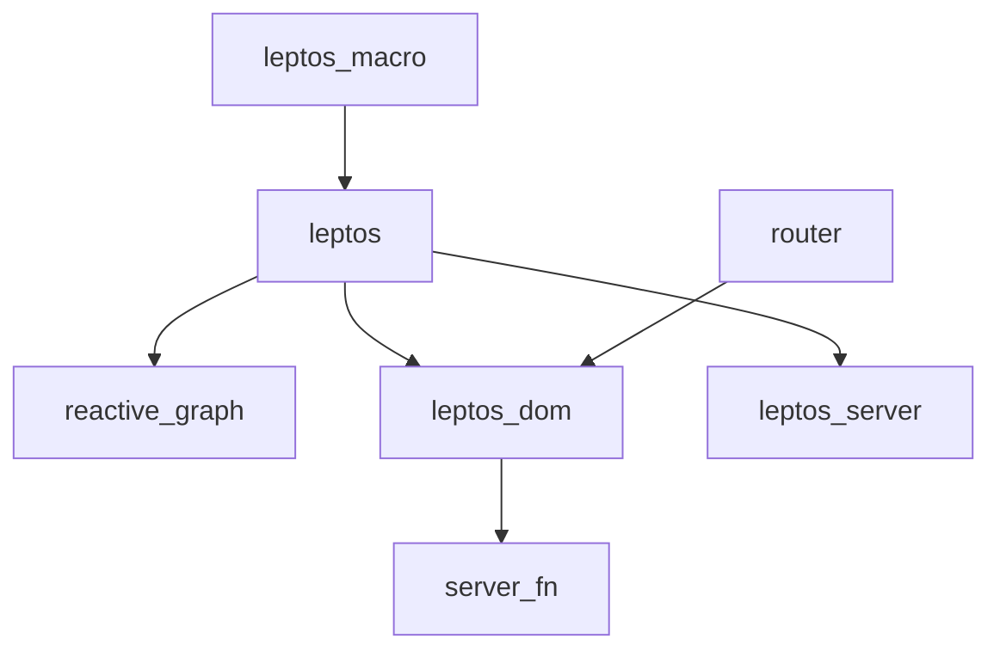

# leptos-rs/leptos

> Framework web Rust full-stack à réactivité fine, pour qui veut des interfaces sans DOM virtuel.

## Le problème
Écrire front et back en Rust sans maintenir une API séparée ni payer le coût d'un DOM virtuel.

## Ce que ça fait vraiment
Des signaux réactifs mettent à jour directement les nœuds du DOM. Le framework couvre rendu navigateur, rendu serveur et hydratation, avec streaming HTML. Des fonctions serveur s'appellent comme des fonctions locales. Un routeur et un outil de build (`cargo-leptos`) complètent l'ensemble.

## Comment c'est branché
Schéma d'après le diagramme fourni, réduit.



## Essayer
```bash
cargo install cargo-leptos --locked
cargo leptos new --git https://github.com/leptos-rs/start-axum
cd [your project name]
cargo leptos watch
```
Puis ouvrir http://localhost:3000/.

## Coût et pièges
Gratuit (MIT). Il faut une chaîne Rust et la cible wasm. Sur wasm, `getrandom` demande la fonction `js` activée. Le livre officiel est encore en cours d'écriture.

## Ce que ce n'est pas
Pas un framework de données ou d'IA. Le rendu générique pour GUI natif a été mis de côté pour la version 0.7. Des bugs existent, l'auteur le dit.

## Alternatives
- Yew : le plus utilisé, mais fondé sur un DOM virtuel.
- Dioxus : meilleure expérience pour des applications de bureau.
- Sycamore : proche dans l'esprit, communauté plus petite.

## Pour toi
À surveiller : pertinent seulement si tu fais des interfaces web en Rust ; pour des tableaux de bord data, Python reste plus direct.

