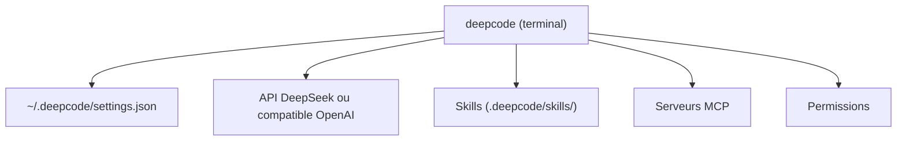

# lessweb/deepcode-cli

> Terminal coding assistant tuned for DeepSeek models, with skills, MCP and reasoning tuning.

## The problem
Popular coding assistants are tuned for other models. According to the README, a harness's tools fit poorly with the habits of a model that was not trained with them.

## What it actually does
It launches a coding agent in the terminal, connected to `deepseek-flash`, `deepseek-v4-pro` or any OpenAI-compatible model. It handles skills (`.deepcode/skills/`), MCP, fine-grained permissions, `/compact`, `/undo` and cached context to reduce costs. It reads images and can search the web. The configuration is shared with the VSCode plugin.

## How it is wired
Simplified diagram based on the sheet, no diagram provided.



## Trying it
```bash
npm install -g @vegamo/deepcode-cli
deepcode
deepcode --plus
```

## Cost and gotchas
A DeepSeek (or compatible) API key is required, billed per usage. The DeepCode Plus subscription is optional. The documentation is written in Chinese.

## What it is not
It is not a neutral agent: it is built for DeepSeek. It is not limited to YOLO mode: permissions are configurable. The announced gain over Claude Code rests on a benchmark published by the authors.

## Alternatives
No alternative named in the README, apart from Claude Code, cited for comparison.

## For you
Worth watching if you run DeepSeek daily: a dedicated harness with cache and skills deserves a try, but the README alone does not prove the claimed superiority.
