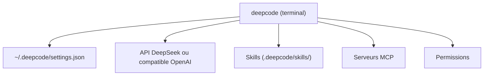

# lessweb/deepcode-cli

> Assistant de code en terminal réglé pour les modèles DeepSeek, avec skills, MCP et réglage du raisonnement.

## Le problème
Les assistants de code populaires sont réglés pour d'autres modèles. Selon le README, les outils d'un harness s'accordent mal aux habitudes d'un modèle qui n'a pas été entraîné avec eux.

## Ce que ça fait vraiment
Il lance un agent de code dans le terminal, branché sur `deepseek-flash`, `deepseek-v4-pro` ou tout modèle compatible OpenAI. Il gère les skills (`.deepcode/skills/`), MCP, les permissions fines, `/compact`, `/undo` et le contexte en cache pour réduire les coûts. Il lit des images et peut chercher sur le web. La configuration est partagée avec le plugin VSCode.

## Comment c'est branché
Schéma simplifié d'après la fiche, sans diagramme fourni.



## Essayer
```bash
npm install -g @vegamo/deepcode-cli
deepcode
deepcode --plus
```

## Coût et pièges
Il faut une clé d'API DeepSeek (ou compatible), facturée à l'usage. L'abonnement DeepCode Plus est optionnel. La documentation est écrite en chinois.

## Ce que ce n'est pas
Ce n'est pas un agent neutre : il est taillé pour DeepSeek. Ce n'est pas limité au mode YOLO : les permissions sont configurables. Le gain annoncé face à Claude Code repose sur un benchmark publié par les auteurs.

## Alternatives
Aucune alternative nommée dans le README, hors Claude Code, cité en comparaison.

## Pour toi
À surveiller si tu fais tourner DeepSeek au quotidien : un harness dédié avec cache et skills mérite un essai, mais le README seul ne prouve pas la supériorité annoncée.

