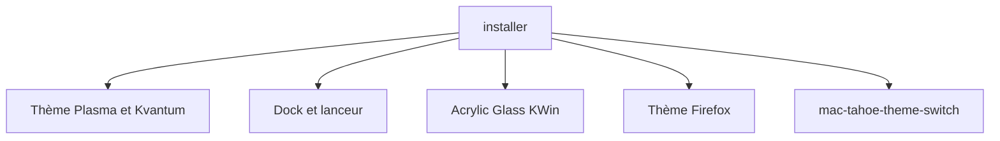

# lestercorderomurillo/macos-tahoe-liquid-kde

> Theme and installer that dress up KDE Plasma 6 like macOS Tahoe, for Linux users.

## The problem
A KDE desktop does not look like macOS: the dock, launcher, frosted glass, global menus and boot animation all have to be redone.

## What it actually does
A graphical wizard installs the Plasma theme, Kvantum, GTK, cursors, dock, launcher, KWin glass effects, Firefox theme, Nautilus and boot screen. Automatic light and dark switching, optional OLED protection, experimental NixOS modules. Eleven distributions tested in a virtual machine.

## How it is wired
Simplified diagram based on the sheet, no diagram provided.


## Trying it
```bash
git clone --filter=blob:none https://github.com/lestercorderomurillo/macos-tahoe-liquid-kde.git
cd macos-tahoe-liquid-kde
./installer
```

## Cost and gotchas
Free. Plasma 6.6 or later, Python 3.10 and PyQt6; cmake and g++ for the compiled effects. Experimental: a desktop update can break compatibility.

## What it is not
Not affiliated with Apple or KDE. Apple wallpapers, sounds and fonts are not covered by the GPL-3.0 license.

## Alternatives
No alternative named in the README.

## For you
Ignore: desktop customization, with no link to data, AI or MLOps work.
