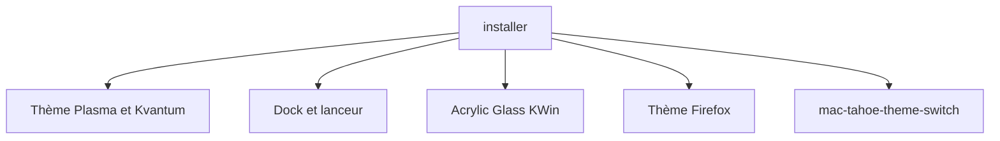

# lestercorderomurillo/macos-tahoe-liquid-kde

> Thème et installateur qui habillent KDE Plasma 6 comme macOS Tahoe, pour les utilisateurs Linux.

## Le problème
Un bureau KDE ne ressemble pas à macOS : dock, lanceur, verre dépoli, menus globaux et animation de démarrage sont à refaire.

## Ce que ça fait vraiment
Un assistant graphique installe thème Plasma, Kvantum, GTK, curseurs, dock, lanceur, effets de verre KWin, thème Firefox, Nautilus et écran de démarrage. Bascule automatique clair et sombre, protection OLED optionnelle, modules NixOS expérimentaux. Onze distributions testées en machine virtuelle.

## Comment c'est branché
Schéma simplifié d'après la fiche, sans diagramme fourni.


## Essayer
```bash
git clone --filter=blob:none https://github.com/lestercorderomurillo/macos-tahoe-liquid-kde.git
cd macos-tahoe-liquid-kde
./installer
```

## Coût et pièges
Gratuit. Plasma 6.6 ou plus, Python 3.10 et PyQt6 ; cmake et g++ pour les effets compilés. Expérimental : une mise à jour du bureau peut casser la compatibilité.

## Ce que ce n'est pas
Pas affilié à Apple ni à KDE. Les fonds d'écran, sons et polices Apple ne sont pas couverts par la licence GPL-3.0.

## Alternatives
Aucune alternative nommée dans le README.

## Pour toi
À ignorer : de la personnalisation de bureau, sans lien avec un travail data, IA ou MLOps.

