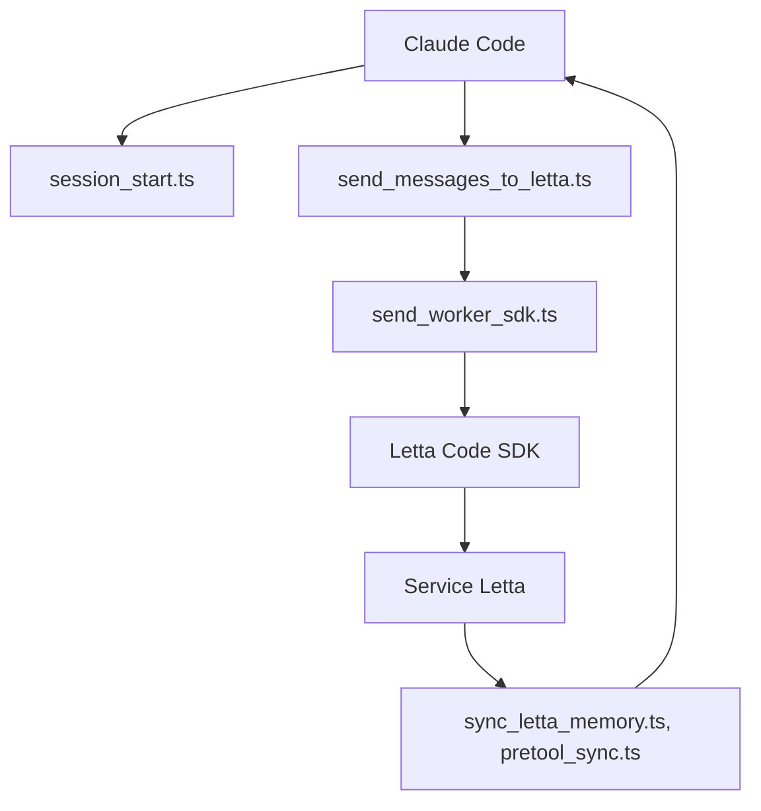

# letta-ai/claude-subconscious

> Claude Code plugin that hands memory and advice between sessions to a background Letta agent.

## The problem
Claude Code forgets everything between two sessions. Project context and your preferences have to be explained again.

## What it actually does
Four Claude Code hooks (SessionStart, UserPromptSubmit, PreToolUse, Stop) send the transcript to a Letta agent via the Letta Code SDK. The agent reads files (Read, Grep, Glob), searches the web and updates its memory blocks. Its messages come back into the prompt through stdout, without touching CLAUDE.md. One agent can serve several projects.

## How it is wired


## Trying it
```bash
/plugin marketplace add letta-ai/claude-subconscious
/plugin install claude-subconscious@claude-subconscious

export LETTA_API_KEY="your-api-key"
```

## Cost and gotchas
A `LETTA_API_KEY` (app.letta.com account) is required; the default model is free on Letta Cloud. A self-hosted Letta is possible via `LETTA_BASE_URL`. The full transcript goes to Letta: weigh this according to your code's confidentiality.

## What it is not
The README warns: it is a demo application, not intended for production. For a coding agent with background subagents, it points to Letta Code.

## Alternatives
Letta Code (`npm install -g @letta-ai/letta-code`): the full coding agent, recommended by the README itself.

## For you
Worth watching: interesting persistent-memory idea, but explicitly a demo, and your code transits through a third-party service.
