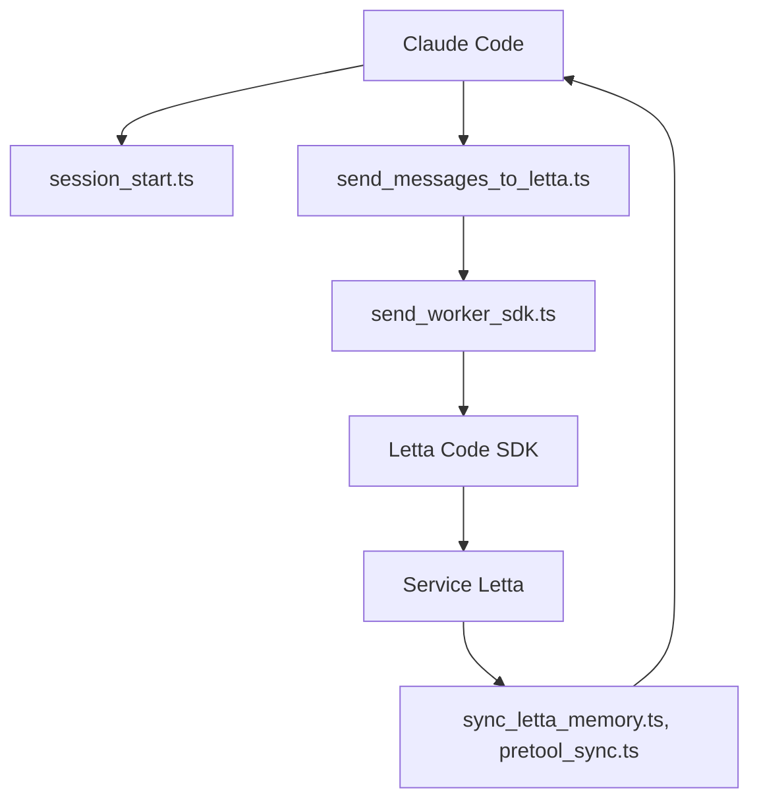

# letta-ai/claude-subconscious

> Plugin Claude Code qui confie à un agent Letta en arrière-plan la mémoire et les conseils entre sessions.

## Le problème
Claude Code oublie tout entre deux sessions. Le contexte de projet et tes préférences sont à réexpliquer.

## Ce que ça fait vraiment
Quatre hooks Claude Code (SessionStart, UserPromptSubmit, PreToolUse, Stop) envoient le transcript à un agent Letta via le SDK Letta Code. L'agent lit les fichiers (Read, Grep, Glob), cherche sur le web et met à jour ses blocs de mémoire. Ses messages reviennent dans le prompt par stdout, sans toucher à CLAUDE.md. Un même agent peut servir plusieurs projets.

## Comment c'est branché


## Essayer
```bash
/plugin marketplace add letta-ai/claude-subconscious
/plugin install claude-subconscious@claude-subconscious

export LETTA_API_KEY="your-api-key"
```

## Coût et pièges
Une clé `LETTA_API_KEY` (compte app.letta.com) est requise ; le modèle par défaut est gratuit sur Letta Cloud. Un Letta auto-hébergé est possible via `LETTA_BASE_URL`. Le transcript complet part chez Letta : à peser selon la confidentialité du code.

## Ce que ce n'est pas
Le README prévient : c'est une application de démonstration, non prévue pour la production. Pour un agent de code avec sous-agents de fond, il renvoie vers Letta Code.

## Alternatives
Letta Code (`npm install -g @letta-ai/letta-code`) : l'agent de code complet, recommandé par le README lui-même.

## Pour toi
À surveiller : idée intéressante de mémoire persistante, mais démo explicite, et ton code transite par un service tiers.

