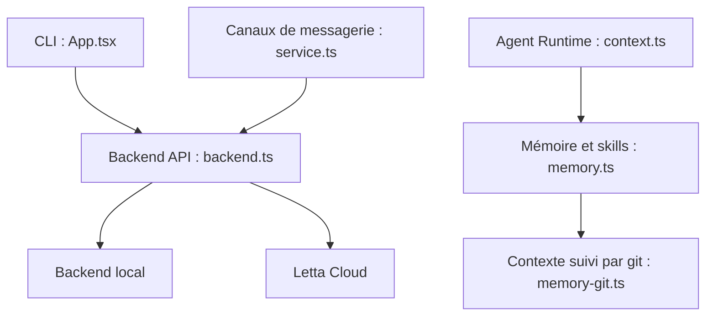

# letta-ai/letta-code

> Coding-agent harness with persistent memory, available as a CLI, in the browser or via messaging, for developers.

## The problem
Coding agents forget everything between sessions: context, preferences, acquired skills.

## What it actually does
A CLI that runs agents equipped with memory (git-tracked memory blocks, "MemFS"), skills, sub-agents, hooks, permissions and scheduled tasks. Agents can rewrite their own context, including via "mods". The backend can be Letta Cloud (the default) or local; remote computers connect with `letta server`.

## How it is wired


## Trying it
```bash
npm install -g @letta-ai/letta-code
letta
letta --new-agent --personality tutorial
```
Alternative: `uv tool install letta` or `pipx install letta`.

## Cost and gotchas
The software is free, but Letta Cloud is the default choice and some features (remote computers, secrets) require a Letta account. Models use your own API keys (`/connect`).

## What it is not
Not an autonomous coding assistant that works without tuning: the memory requires configuration. The AgentFile (`.af`) format has been removed.

## Alternatives
- No alternative named in the README.

## For you
Worth watching: the idea of git-tracked agent memory is relevant for applied AI, but the dependence on Letta Cloud and the 332 open issues call for waiting a little.
