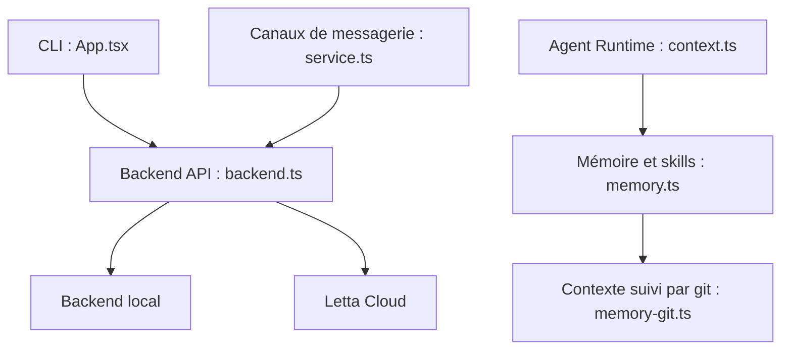

# letta-ai/letta-code

> Harnais d'agents de code à mémoire persistante, en CLI, navigateur ou messagerie, pour développeurs.

## Le problème
Les agents de code oublient tout entre sessions : contexte, préférences, compétences acquises.

## Ce que ça fait vraiment
Un CLI qui fait tourner des agents dotés de mémoire (blocs de mémoire suivis par git, « MemFS »), de skills, de sous-agents, de hooks, de permissions et de tâches planifiées. Les agents peuvent réécrire leur propre contexte, y compris via des « mods ». Le backend peut être Letta Cloud (par défaut) ou local ; des ordinateurs distants se connectent avec `letta server`.

## Comment c'est branché


## Essayer
```bash
npm install -g @letta-ai/letta-code
letta
letta --new-agent --personality tutorial
```
Alternative : `uv tool install letta` ou `pipx install letta`.

## Coût et pièges
Le logiciel est libre, mais Letta Cloud est le choix par défaut et certaines fonctions (ordinateurs distants, secrets) exigent un compte Letta. Les modèles utilisent tes clés d'API (`/connect`).

## Ce que ce n'est pas
Pas un assistant de code autonome sans réglage : la mémoire demande de la configuration. Le format AgentFile (`.af`) est supprimé.

## Alternatives
- Aucune alternative nommée dans le README.

## Pour toi
À surveiller : l'idée d'agents à mémoire git-trackée est pertinente pour l'IA appliquée, mais la dépendance à Letta Cloud et les 332 issues ouvertes appellent à attendre un peu.

