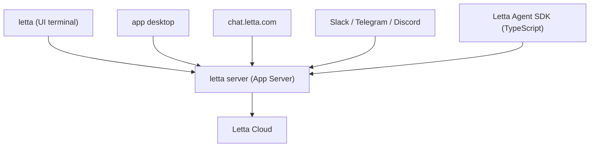

# letta-ai/letta

> Agents with persistent memory; this repository is now only a signpost to the real code.

## The problem
An LLM agent starts from zero every session: nothing it learned yesterday survives.
Letta (formerly MemGPT) treats memory as first-class state.

## What it actually does
The README explicitly announces that the active code lives in `letta-ai/letta-code`: agent harness,
interactive terminal UI, App Server, channels, desktop and web app runtime. This repository keeps
the `archive` branch, which contains the retired Letta V1 API server, with tags and releases.
No technical description of how it works is given here.

## How it is wired


## Trying it
```bash
npm install -g @letta-ai/letta-code
letta
letta server
```

## Cost and gotchas
Letta Cloud is the default path to keep memory, identity and conversations across machines:
it is a hosted service, so an account and a potential bill. Nothing here indicates the cost of
self-hosting or which LLM models are required.

## What it is not
Not the repository to clone: the code is elsewhere, and this README says so. Not technical documentation —
you have to go to the Letta documentation for any installation or deployment information.
The `archive` branch is explicitly retired, not a starting point.

## Alternatives
- `letta-ai/letta-code`: the repository actually under development, named in the README.

## For you
Go straight to `letta-code`; this repository is only useful for retrieving the V1 history.
