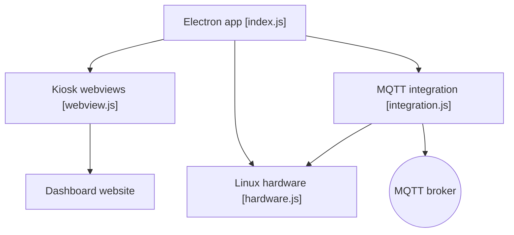

# leukipp/touchkio

> Electron kiosk-mode application to display a Home Assistant dashboard on a Linux touchscreen.

## The problem
A full-screen browser on a touchscreen Raspberry Pi handles touch, screen blanking and the virtual keyboard poorly.

## What it actually does
Opens one or more pages in full-screen touch mode with a bar, a side widget and a pager. Via MQTT, it exposes sensors and commands to Home Assistant: brightness, screen power, volume, battery, temperature, CPU/RAM, screenshots, reboot. Installs a user systemd service.

## How it is wired


## Trying it
```bash
bash <(wget -qO- https://raw.githubusercontent.com/leukipp/touchkio/main/install.sh)
touchkio --web-url=http://192.168.1.42:8123 --mqtt-url=mqtt://192.168.1.42:1883 --mqtt-user=user --mqtt-password=password
```

## Cost and gotchas
Free. An MQTT broker is required for the sensors. The MQTT password is stored in `~/.config/touchkio/Arguments.json`, obfuscated but easy to recover (the README says so). Read the installation script before running it.

## What it is not
Not a general monitoring tool: it only targets Linux with a touchscreen. Electron is resource-hungry. No Windows or macOS compatibility documented.

## Alternatives
No alternative named in the README.

## For you
Ignore: home automation and Raspberry Pi, unrelated to your data / AI / MLOps profile, unless you have a Home Assistant dashboard.
