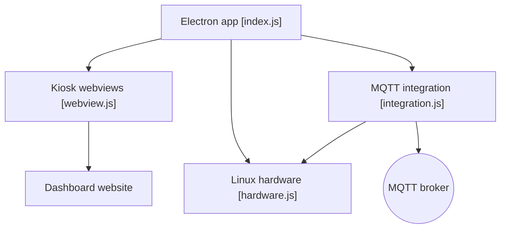

# leukipp/touchkio

> Application Electron en mode kiosque pour afficher un tableau de bord Home Assistant sur écran tactile Linux.

## Le problème
Le navigateur plein écran sur un Raspberry Pi à écran tactile gère mal le tactile, l'extinction d'écran et le clavier virtuel.

## Ce que ça fait vraiment
Ouvre une ou plusieurs pages en plein écran tactile avec barre, widget latéral et pager. Via MQTT, expose à Home Assistant capteurs et commandes : luminosité, alimentation de l'écran, volume, batterie, température, CPU/RAM, captures, redémarrage. Installe un service systemd utilisateur.

## Comment c'est branché


## Essayer
```bash
bash <(wget -qO- https://raw.githubusercontent.com/leukipp/touchkio/main/install.sh)
touchkio --web-url=http://192.168.1.42:8123 --mqtt-url=mqtt://192.168.1.42:1883 --mqtt-user=user --mqtt-password=password
```

## Coût et pièges
Gratuit. Il faut un broker MQTT pour les capteurs. Le mot de passe MQTT est stocké dans `~/.config/touchkio/Arguments.json`, obfusqué mais facile à retrouver (le README le dit). Script d'installation à lire avant exécution.

## Ce que ce n'est pas
Pas un outil de monitoring général : il ne vise que Linux avec écran tactile. Electron est gourmand en ressources. Pas de compatibilité Windows ni macOS documentée.

## Alternatives
Aucune alternative nommée dans le README.

## Pour toi
Ignorer : domotique et Raspberry Pi, sans lien avec ton profil data / IA / MLOps, à moins d'avoir un tableau de bord Home Assistant.

