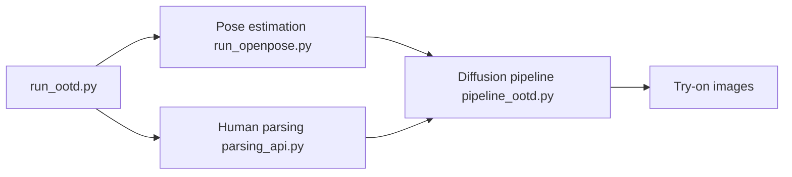

# levihsu/OOTDiffusion

> Official implementation of a latent-diffusion virtual try-on, with half-body and full-body models.

## The problem
Visualizing a garment on a person without a real photo.

## What it actually does
From a photo of a person and a garment, the pipeline estimates pose (OpenPose) and segments the body (humanparsing, ONNX supported), then a diffusion UNet merges garment and person. VITON-HD (half-body) and Dress Code (full-body) checkpoints. A Gradio demo is provided.

## How it is wired


## Trying it
```bash
conda create -n ootd python==3.10
pip install torch==2.0.1 torchvision==0.15.2 torchaudio==2.0.2
pip install -r requirements.txt
cd OOTDiffusion/run
python run_ootd.py --model_path <model-image-path> --cloth_path <cloth-image-path> --scale 2.0 --sample 4
```

## Cost and gotchas
GPU needed; checkpoints and `clip-vit-large-patch14` to download. Tested only on Ubuntu 22.04. License not identified.

## What it is not
Training code is not released (box unchecked). Last push in May 2024.

## Alternatives
No alternative named in the README.

## For you
Ignore: code frozen since 2024, uncertain license, no training: useful only as reading material.
