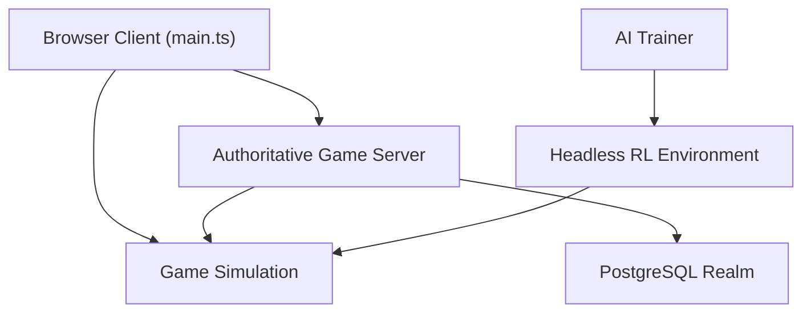

# levy-street/world-of-claudecraft

> Classic MMO playable in the browser, with a Gymnasium environment to train agents.

## The problem
Training a reinforcement-learning agent on a complex game requires a faithful, reproducible environment.

## What it actually does
A web MMO with a single deterministic simulation, run in three ways: a multiplayer server with accounts on PostgreSQL, a local offline world, and a headless RL environment exposed as Gymnasium (reset, step, close) via JSON over stdio. The game has nine classes, dungeons, PvP and desktop and mobile apps. A $WOC token on Solana is optional. The README is truncated in this block.

## How it is wired


## Trying it
```bash
cp .env.example .env
docker compose up -d --build
npm run build:env
pip install gymnasium numpy
python python/example_random_agent.py
```

## Cost and gotchas
Free; hosting requires a strong PostgreSQL password and a TLS proxy. Docker and Node are required. The web3 side ($WOC) is optional and involves real payments: be careful.

## What it is not
It is not a generic RL environment: it serves only this game. The use of the Claude name is a game reference, not an Anthropic product.

## Alternatives
No alternative named in the README.

## For you
Worth watching: the deterministic RL environment is a good curiosity for testing agents, but the rest is a full game, heavy to host.
