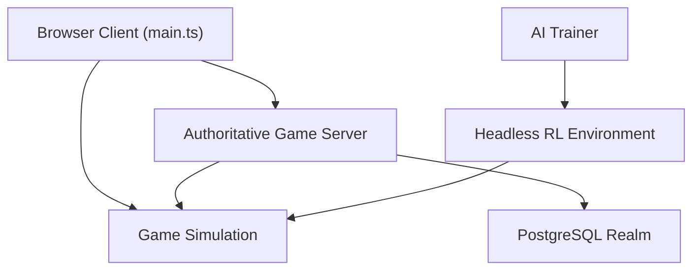

# levy-street/world-of-claudecraft

> MMO classique jouable dans le navigateur, avec un environnement Gymnasium pour entraîner des agents.

## Le problème
Entraîner un agent par renforcement sur un jeu complexe demande un environnement fidèle et reproductible.

## Ce que ça fait vraiment
Un MMO web à une simulation déterministe unique, exécutée de trois façons : serveur multiplayer avec comptes sur PostgreSQL, monde local hors ligne, et environnement RL sans interface exposé en Gymnasium (reset, step, close) via JSON sur stdio. Le jeu compte neuf classes, des donjons, du PvP et des applications de bureau et mobiles. Un jeton $WOC sur Solana est facultatif. Le README est tronqué dans ce bloc.

## Comment c'est branché


## Essayer
```bash
cp .env.example .env
docker compose up -d --build
npm run build:env
pip install gymnasium numpy
python python/example_random_agent.py
```

## Coût et pièges
Gratuit ; l'hébergement exige un mot de passe PostgreSQL fort et un proxy TLS. Docker et Node sont nécessaires. Le volet web3 ($WOC) est facultatif et touche à des paiements réels : prudence.

## Ce que ce n'est pas
Ce n'est pas un environnement RL générique : il ne sert que ce jeu. L'usage du nom Claude est une référence de jeu, pas un produit d'Anthropic.

## Alternatives
Aucune alternative nommée dans le README.

## Pour toi
À surveiller : l'environnement RL déterministe est une bonne curiosité pour tester des agents, mais le reste est un jeu complet, lourd à héberger.

