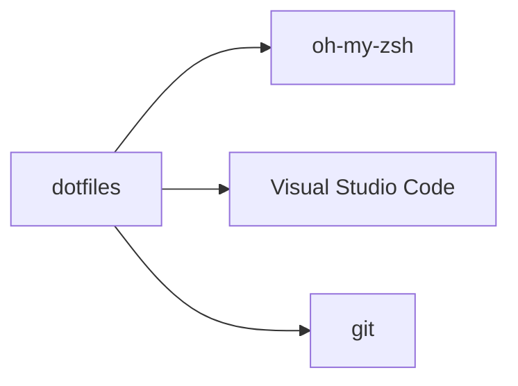

# lewagon/dotfiles

> Development environment configuration files provided to students of the Le Wagon bootcamp.

## The problem
Setting up an identical development workstation for all students of a training program.

## What it actually does
The README only states that the repository is for Le Wagon students, with oh-my-zsh, Visual Studio Code and git as tools. No detail on the contents of the files.

## How it is wired
Simplified diagram based on the sheet, no diagram provided.

## Trying it
No command documented in the README.

## Cost and gotchas
Free (MIT). Designed for the Le Wagon curriculum: use outside the training is not described.

## What it is not
Not a generic tool nor a configuration framework. No installation documentation in the README.

## Alternatives
No alternative named in the README.

## For you
Ignore: bootcamp configuration, too specific and too poorly documented to replace your own dotfiles.
