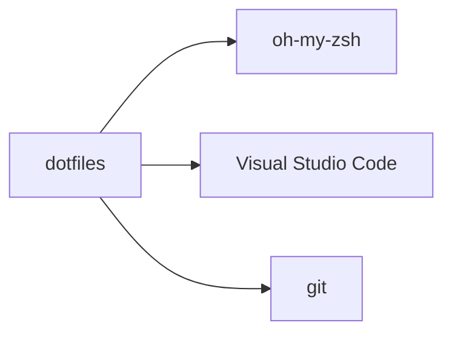

# lewagon/dotfiles

> Fichiers de configuration d'environnement de développement fournis aux élèves du bootcamp Le Wagon.

## Le problème
Configurer un poste de développement identique pour tous les élèves d'une formation.

## Ce que ça fait vraiment
Le README indique seulement que le dépôt sert aux élèves de Le Wagon, avec comme outils oh-my-zsh, Visual Studio Code et git. Aucun détail sur le contenu des fichiers.

## Comment c'est branché
Schéma simplifié d'après la fiche, sans diagramme fourni.

## Essayer
Aucune commande documentée dans le README.

## Coût et pièges
Gratuit (MIT). Pensé pour le cursus Le Wagon : l'usage hors formation n'est pas décrit.

## Ce que ce n'est pas
Pas un outil générique ni un framework de configuration. Pas de documentation d'installation dans le README.

## Alternatives
Aucune alternative nommée dans le README.

## Pour toi
À ignorer : configuration de bootcamp, trop spécifique et trop peu documentée pour remplacer tes propres dotfiles.

