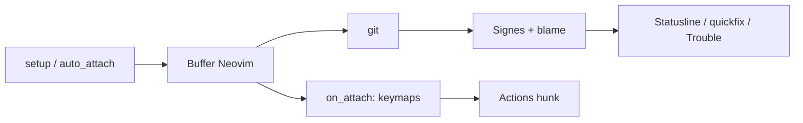

# lewis6991/gitsigns.nvim

> Neovim plugin that shows git changes in the gutter and lets you act on hunks.

## The problem
In Neovim, seeing what changed relative to git, and staging or reverting a portion of a file, forces you to leave the editor or use manual commands.

## What it actually does
- Marks added, modified and deleted lines in the sign column, with distinct signs for staged changes.
- Stage, reset, preview and navigate by hunk, including partial selection.
- Blame for the buffer or the current line (virtual text), diff against the index or a revision, word diff.
- Quickfix list of hunks, `ih` text object, statusline variables (`b:gitsigns_status`).

## How it is wired

Internal code detail: not documented in the README.

## Trying it
```bash
# aucune commande shell ; via le gestionnaire de paquets Neovim, puis dans init.lua :
#   require('gitsigns').setup { current_line_blame = true }
:Gitsigns stage_hunk
:Gitsigns blame_line
:Gitsigns toggle_current_line_blame
```

## Cost and gotchas
Free, no account. Requires Neovim >= 0.11.0 and a recent git; an outdated Neovim `master` version may break. Keymaps are not set by default: they go through `on_attach`.

## What it is not
Not a clone of vim-fugitive: the README refuses to implement all of its functions. Does not work on classic Vim. Files over 40,000 lines are disabled by default.

## Alternatives
- mini.diff: cited in the README as a similar plugin.
- vim-gitgutter: likewise, the historical version.
- vim-signify: likewise.

## For you
Adopt if you code in Neovim (notebooks, MLOps scripts): MIT, 7,146 stars, push on 2026-10-22, but a single maintainer.
