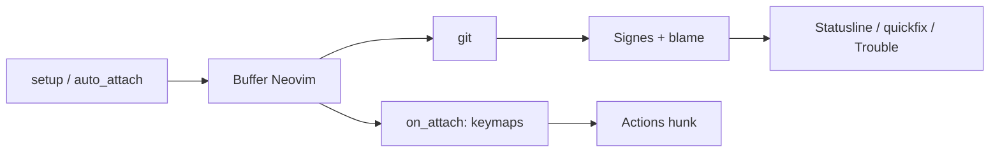

# lewis6991/gitsigns.nvim

> Plugin Neovim qui affiche les modifications git dans la marge et permet d'agir sur les hunks.

## Le problème
Dans Neovim, voir ce qui a changé par rapport à git, et indexer ou annuler une portion de fichier, oblige à quitter l'éditeur ou à passer par des commandes manuelles.

## Ce que ça fait vraiment
- Marque dans la colonne de signes les lignes ajoutées, modifiées, supprimées, avec des signes distincts pour les changements indexés.
- Stage, reset, prévisualisation et navigation par hunk, y compris en sélection partielle.
- Blame du buffer ou de la ligne courante (texte virtuel), diff contre l'index ou une révision, diff de mots.
- Liste quickfix des hunks, objet texte `ih`, variables de statusline (`b:gitsigns_status`).

## Comment c'est branché

Détail interne du code : non documenté dans le README.

## Essayer
```bash
# aucune commande shell ; via le gestionnaire de paquets Neovim, puis dans init.lua :
#   require('gitsigns').setup { current_line_blame = true }
:Gitsigns stage_hunk
:Gitsigns blame_line
:Gitsigns toggle_current_line_blame
```

## Coût et pièges
Gratuit, aucun compte. Exige Neovim >= 0.11.0 et un git récent ; une version de Neovim `master` en retard peut casser. Les raccourcis ne sont pas posés par défaut : ils passent par `on_attach`.

## Ce que ce n'est pas
Pas un clone de vim-fugitive : le README refuse d'implémenter toutes ses fonctions. Ne marche pas sur Vim classique. Fichiers de plus de 40 000 lignes désactivés par défaut.

## Alternatives
- mini.diff : cité dans le README comme plugin similaire.
- vim-gitgutter : idem, version historique.
- vim-signify : idem.

## Pour toi
Adopter si tu codes dans Neovim (notebooks, scripts MLOps) : MIT, 7 146 étoiles, push du 2026-10-22, mais un seul mainteneur.

