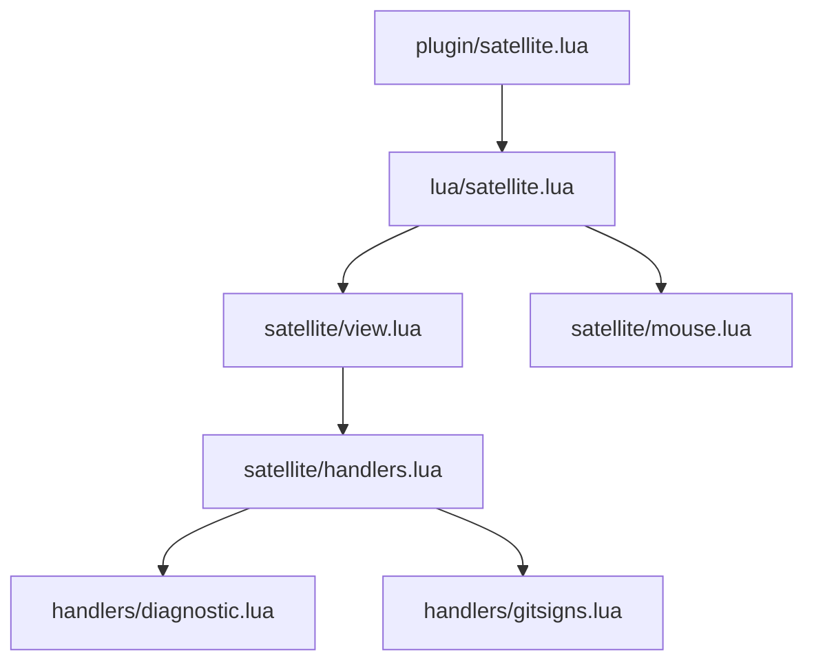

# lewis6991/satellite.nvim

> Neovim plugin that displays a scrollbar decorated with marks (diagnostics, git, search).

## The problem
In a long file, you cannot see where the errors, search results or git hunks are.

## What it actually does
Draws a sidebar with marks for cursor, search, diagnostics, gitsigns hunks, marks and quickfix. Handles folds and the mouse. The README states that poorly optimized workarounds compensate for missing Neovim APIs. Commands `:SatelliteEnable`, `:SatelliteDisable`, `:SatelliteRefresh`.

## How it is wired


## Trying it
```bash
# Dans Neovim :
# require('satellite').setup {}
# :help satellite
```

## Cost and gotchas
Free. Requires Neovim nightly. Can get out of sync after certain window changes.

## What it is not
Not a standard scrollbar: imperfect workarounds stand in for missing APIs.

## Alternatives
- nvim-scrollview: normal scrollbar implementation, from which satellite is derived.
- nvim-scrollbar: another similar plugin.

## For you
Editor comfort for Neovim users; no direct interest for data / AI, ignore.
