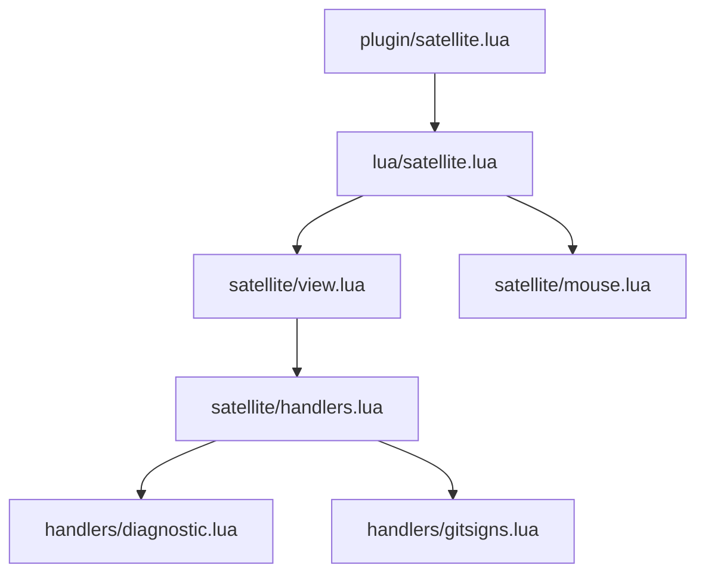

# lewis6991/satellite.nvim

> Plugin Neovim qui affiche une barre de défilement décorée de marques (diagnostics, git, recherche).

## Le problème
Dans un long fichier, on ne voit pas où sont les erreurs, résultats de recherche ou hunks git.

## Ce que ça fait vraiment
Dessine une barre latérale avec marques pour curseur, recherche, diagnostics, hunks gitsigns, marks et quickfix. Gère les replis et la souris. Le README précise que des contournements peu optimisés pallient des API Neovim manquantes. Commandes `:SatelliteEnable`, `:SatelliteDisable`, `:SatelliteRefresh`.

## Comment c'est branché


## Essayer
```bash
# Dans Neovim :
# require('satellite').setup {}
# :help satellite
```

## Coût et pièges
Gratuit. Exige Neovim nightly. Peut se désynchroniser après certains changements de fenêtres.

## Ce que ce n'est pas
Pas une barre de défilement standard : des contournements imparfaits tiennent lieu d'API manquantes.

## Alternatives
- nvim-scrollview : implémentation de barre de défilement normale, dont satellite est dérivé.
- nvim-scrollbar : autre plugin similaire.

## Pour toi
Confort d'éditeur pour utilisateurs de Neovim ; aucun intérêt direct en data / IA, à ignorer.

