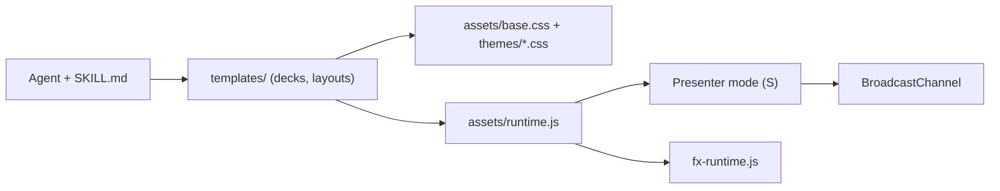

# lewislulu/html-ppt-skill

> Agent skill that generates static HTML presentations with themes, layouts, animations and a presenter mode.

## The problem
Producing a clean deck takes a heavy tool or hand-written CSS every time.

## What it actually does
A `SKILL.md` guides the agent to assemble decks from static files: 36 themes (CSS tokens), 15 complete decks, layouts, 27 CSS animations and 20 canvas effects. The `S` key opens a presenter window (current slide, next slide, script, timer) synchronized via `BroadcastChannel`. No build step, PNG rendering via headless Chrome.

## How it is wired


## Trying it
```bash
npx skills add https://github.com/lewislulu/html-ppt-skill
./scripts/new-deck.sh my-talk
./scripts/render.sh examples/my-talk/index.html 12
```

## Cost and gotchas
Free. `npx skills` needs network access (manual copy to `~/.claude/skills/html-ppt/` is possible). The only remote dependency: Google fonts in `assets/fonts.css`; offline, the browser falls back to the system font stack. The `docs/` folder weighs about 4.6 MB.

## What it is not
Not a PowerPoint export: the output is HTML. The README contradicts itself on the number of layouts (36 announced, 31 in the structure). No native PPTX compatibility.

## Alternatives
No alternative named in the README.

## For you
Adopt: zero build, installable as a Claude Code skill with a single copy-paste, useful for presenting data projects without leaving the terminal.
