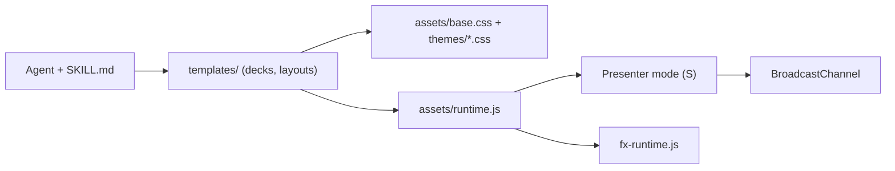

# lewislulu/html-ppt-skill

> Skill d'agent qui génère des présentations HTML statiques avec thèmes, mises en page, animations et mode présentateur.

## Le problème
Produire un deck propre demande un outil lourd ou du CSS écrit à la main à chaque fois.

## Ce que ça fait vraiment
Un `SKILL.md` guide l'agent pour assembler des decks à partir de fichiers statiques : 36 thèmes (jetons CSS), 15 decks complets, des mises en page, 27 animations CSS et 20 effets canvas. La touche `S` ouvre une fenêtre présentateur (diapo courante, suivante, script, minuteur) synchronisée par `BroadcastChannel`. Pas de build, rendu PNG via Chrome headless.

## Comment c'est branché


## Essayer
```bash
npx skills add https://github.com/lewislulu/html-ppt-skill
./scripts/new-deck.sh my-talk
./scripts/render.sh examples/my-talk/index.html 12
```

## Coût et pièges
Gratuit. `npx skills` a besoin du réseau (copie manuelle possible vers `~/.claude/skills/html-ppt/`). Seule dépendance distante : les polices Google dans `assets/fonts.css` ; hors ligne, le navigateur retombe sur la pile système. Le dossier `docs/` pèse environ 4,6 Mo.

## Ce que ce n'est pas
Pas un export PowerPoint : la sortie est du HTML. Le README se contredit sur le nombre de mises en page (36 annoncées, 31 dans la structure). Pas de compat PPTX native.

## Alternatives
Aucune alternative nommée dans le README.

## Pour toi
À adopter : zéro build, installable comme skill Claude Code en un copier-coller, utile pour des restitutions de projets data sans quitter le terminal.

