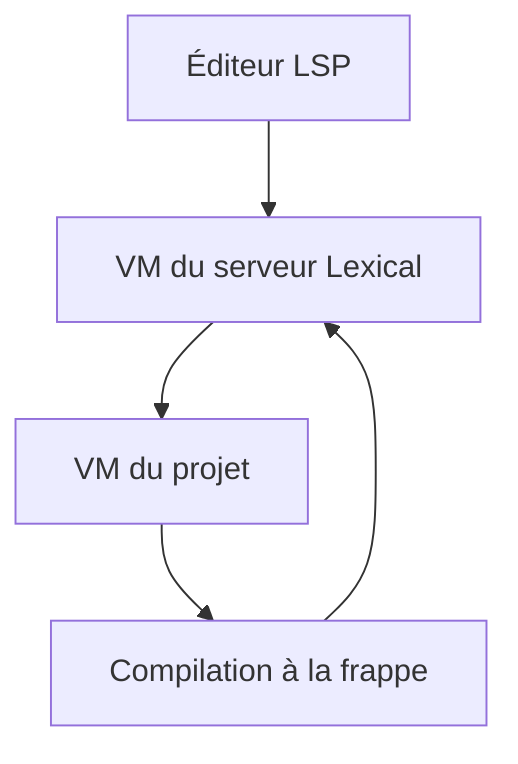

# lexical-lsp/lexical

> Next-generation language server for Elixir, now archived in favor of Expert.

## The problem
Elixir language servers share the project's dependencies and only compile on save.

## What it actually does
Launches two Erlang virtual machines linked by distribution: one for the server, the other for the user's project. This avoids dependency conflicts, allows different Elixir versions and enables compilation as you type. Features: contextual completion, errors, code actions, formatting, go to definition.

## How it is wired

Simplified diagram based on the sheet, no diagram provided.

## Trying it
```bash
mix package
mix package --path /path/to/lexical
mix hooks
```

## Cost and gotchas
Free. Archived repository, last push in February 2025, and no license declared in the catalog. Development continues in the joint Expert effort.

## What it is not
Not the Elixir server to follow: the README announces the slowdown in favor of Expert.

## Alternatives
- Expert: the combined effort to which development is moving.

## For you
Ignore: archived, unlicensed, and reserved for Elixir developers.
