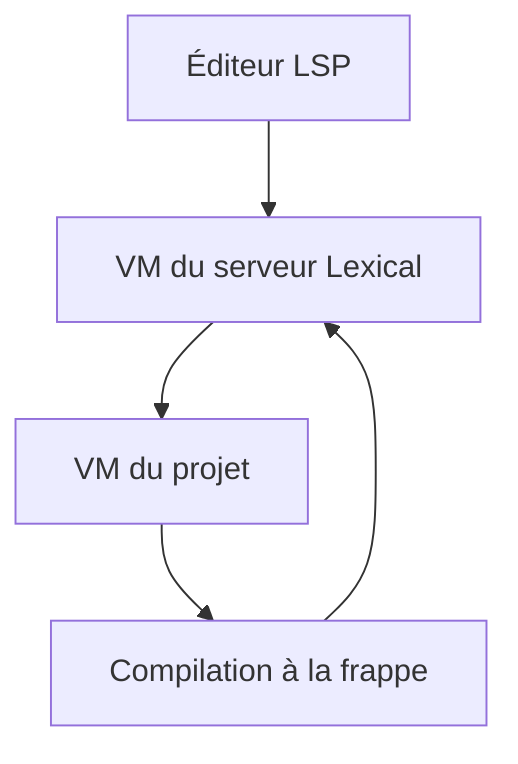

# lexical-lsp/lexical

> Serveur de langage nouvelle génération pour Elixir, désormais archivé au profit d'Expert.

## Le problème
Les serveurs de langage Elixir partagent les dépendances du projet et ne compilent qu'à l'enregistrement.

## Ce que ça fait vraiment
Lance deux machines virtuelles Erlang liées par distribution : l'une pour le serveur, l'autre pour le projet de l'utilisateur. Cela évite les conflits de dépendances, autorise des versions différentes d'Elixir et permet la compilation à la frappe. Fonctions : complétion contextuelle, erreurs, actions de code, formatage, aller à la définition.

## Comment c'est branché

Schéma simplifié d'après la fiche, sans diagramme fourni.

## Essayer
```bash
mix package
mix package --path /path/to/lexical
mix hooks
```

## Coût et pièges
Gratuit. Dépôt archivé, dernier push en février 2025, et aucune licence déclarée au catalogue. Le développement continue dans l'effort commun Expert.

## Ce que ce n'est pas
Pas le serveur Elixir à suivre : le README annonce le ralentissement au profit d'Expert.

## Alternatives
- Expert : l'effort combiné vers lequel le développement se déplace.

## Pour toi
Ignorer : archivé, sans licence, et réservé aux développeurs Elixir.

