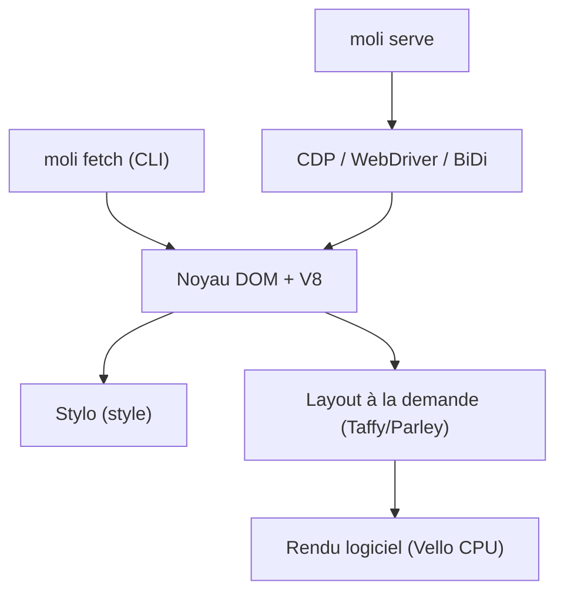

# lexmount/moli

> Headless browser in Rust for AI agents: page extraction and automation, rendering on demand.

## The problem
A full headless Chrome uses a lot of memory while agents mostly need the structure of the page.

## What it actually does
A custom browser core (V8, Stylo, Taffy, Parley), not based on Chromium. By default it reads the DOM with no layout or rendering; `--layout` enables screenshots, PDF and geometry. Outputs HTML, Markdown, JSON, semantic tree. The same server handles CDP, WebDriver Classic and BiDi, and can be used with Playwright.

## How it is wired


## Trying it
```bash
curl --proto '=https' --tlsv1.2 -fsSL https://github.com/lexmount/moli/releases/latest/download/moli-installer.sh | sh
moli fetch --dump markdown --wait-until done https://example.com
moli serve --layout
```

## Cost and gotchas
Free, no prerequisites. The README measurements come from the vendor: 53.6% useful pages over 192 URLs, 81.88% of tasks succeeded on Lexbench versus 99.85% for Chrome.

## What it is not
Not a full replacement for Chrome: no pixel parity, no WebGL or faithful media playback. Version 0.1.1 cited, project created in 2026-08.

## Alternatives
Chrome Headless, Lightpanda, Obscura: compared in the README benchmarks.

## For you
Worth watching: relevant for memory-efficient collection and RAG pipelines; validate on your target sites before depending on it.
