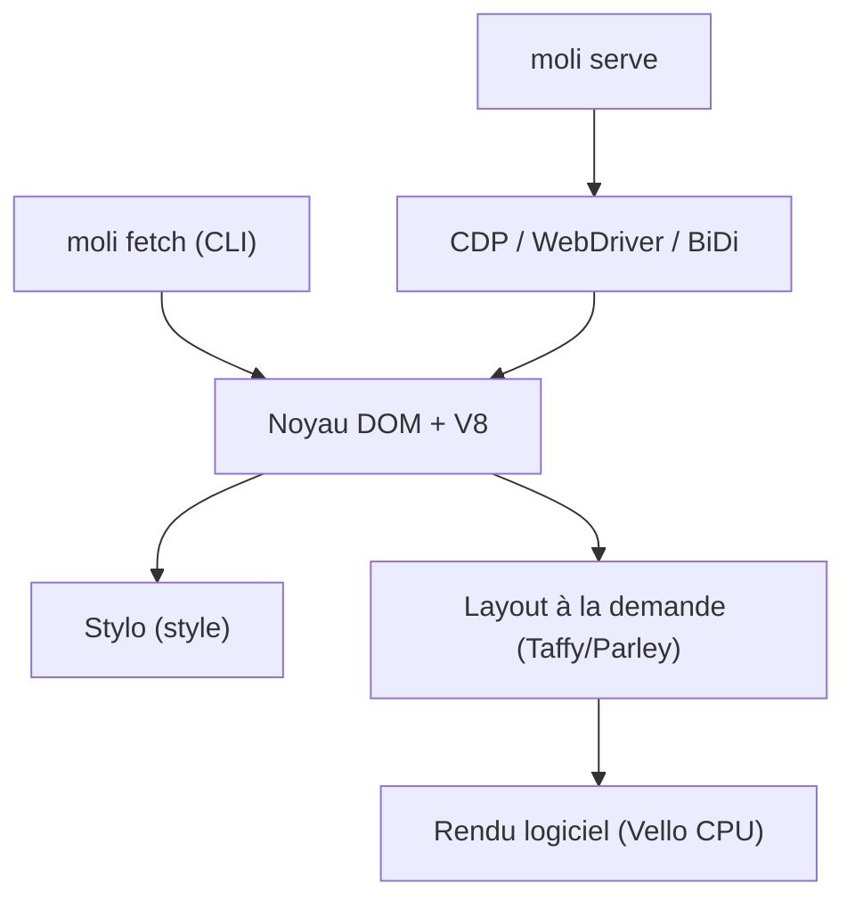

# lexmount/moli

> Navigateur headless en Rust pour agents IA : extraction de pages et automatisation, rendu à la demande.

## Le problème
Un Chrome headless complet consomme beaucoup de mémoire alors que les agents ont surtout besoin de la structure de la page.

## Ce que ça fait vraiment
Un noyau de navigateur propre (V8, Stylo, Taffy, Parley), non basé sur Chromium. Par défaut il lit le DOM sans layout ni rendu ; `--layout` active capture d'écran, PDF et géométrie. Sorties HTML, Markdown, JSON, arbre sémantique. Même serveur pour CDP, WebDriver Classic et BiDi, utilisable avec Playwright.

## Comment c'est branché


## Essayer
```bash
curl --proto '=https' --tlsv1.2 -fsSL https://github.com/lexmount/moli/releases/latest/download/moli-installer.sh | sh
moli fetch --dump markdown --wait-until done https://example.com
moli serve --layout
```

## Coût et pièges
Gratuit, sans prérequis. Les mesures du README viennent du fournisseur : 53,6 % de pages utiles sur 192 URLs, 81,88 % de tâches réussies sur Lexbench contre 99,85 % pour Chrome.

## Ce que ce n'est pas
Pas un remplaçant total de Chrome : pas de parité au pixel, pas de WebGL ni de lecture média fidèle. Version 0.1.1 citée, projet créé en 2026-08.

## Alternatives
Chrome Headless, Lightpanda, Obscura : comparés dans les benchmarks du README.

## Pour toi
À surveiller : pertinent pour des pipelines de collecte et de RAG économes en mémoire ; à valider sur tes sites cibles avant d'en dépendre.

