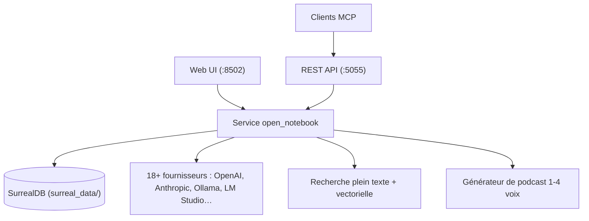

# lfnovo/open-notebook

> Self-hosted alternative to NotebookLM: sources, chat, search and multi-voice podcasts.

## The problem
Entrusting your research documents to a closed service imposes its models, its limits and its hosting, with no API to automate anything.

## What it actually does
Organizes multiple notebooks containing PDFs, videos, audio, web pages and office documents.
Lets you choose among 18+ model providers, including Ollama and LM Studio locally, with default assignments per use.
Searches full-text and by vector across all the content, and lets a model chat with fine control over what is passed to it, with citations to back it up.
Generates podcasts with 1 to 4 voices, with episode profiles and script control. Exposes a full REST API, an MCP integration for Claude Desktop or VS Code, and optional password protection for exposed deployments.

## How it is wired


## Trying it
```bash
curl -o docker-compose.yml https://raw.githubusercontent.com/lfnovo/open-notebook/main/docker-compose.yml
# éditer OPEN_NOTEBOOK_ENCRYPTION_KEY
docker compose up -d
# puis http://localhost:8502
```

## Cost and gotchas
Free apart from the models, which are at your expense, except locally with Ollama. Two points of caution in the provided compose file: `OPEN_NOTEBOOK_ENCRYPTION_KEY` defaults to `change-me-to-a-secret-string` and encrypts your API keys in the database; SurrealDB starts as `root:root`, with the port bound to `127.0.0.1` only.
The README itself admits "basic" citations that lag behind NotebookLM.

## What it is not
It is not a clone at parity: the README's comparison table concedes ground on citations. It is not yet asynchronous: content processing blocks the interface, which is announced as upcoming. It is not multi-notebook for sources: reusing them is upcoming.

## Alternatives
- **Google NotebookLM**: the closed product it aims to be an alternative to.

## For you
The right compromise if you want a NotebookLM on your sensitive documents, with an API for scripting.
