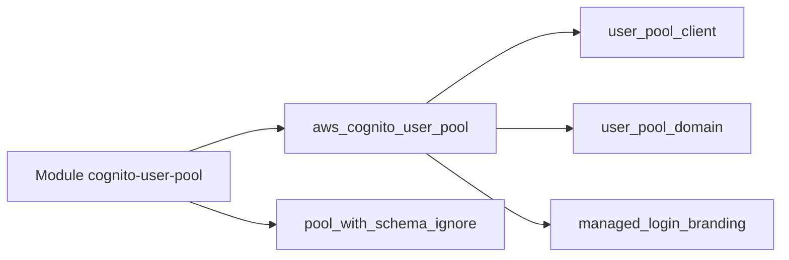

# lgallard/terraform-aws-cognito-user-pool

> Terraform module that creates Amazon Cognito user pools with clients, domain and branding.

## The problem
A Cognito pool has many options, and its immutable schemas cause perpetual diffs under Terraform.

## What it actually does
Creates a user pool, its app clients, its domain, resource servers, groups, identity providers, log delivery and managed login branding. A double set of resources, with or without `ignore_changes` on the schema, is driven by `ignore_schema_changes`.

## How it is wired


## Trying it
```hcl
module "aws_cognito_user_pool_simple" {
  source  = "lgallard/cognito-user-pool/aws"
  user_pool_name = "mypool"
  ignore_schema_changes = true
}
```

## Cost and gotchas
AWS account, Terraform 1.3+, AWS provider 6.12+ (1.14.1+ requires AWS 6.0+). Schemas can no longer be modified after creation: plan for `ignore_schema_changes = true` from the start. Branding may cost extra.

## What it is not
Not an authentication service: it is a Terraform configuration layer around Cognito. It does not manage the users themselves.

## Alternatives
None named in the README.

## For you
Watch: useful if your AI API relies on Cognito for authentication, otherwise of no interest.
