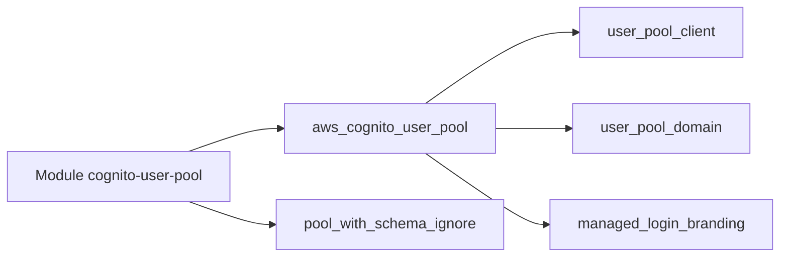

# lgallard/terraform-aws-cognito-user-pool

> Module Terraform qui crée des pools d'utilisateurs Amazon Cognito avec clients, domaine et branding.

## Le problème
Un pool Cognito a beaucoup d'options, et ses schémas immuables provoquent des diffs perpétuels sous Terraform.

## Ce que ça fait vraiment
Crée un pool d'utilisateurs, ses clients d'application, son domaine, ses serveurs de ressources, groupes, fournisseurs d'identité, la livraison de logs et le branding de connexion géré. Un double jeu de ressources, avec ou sans `ignore_changes` sur le schéma, est piloté par `ignore_schema_changes`.

## Comment c'est branché


## Essayer
```hcl
module "aws_cognito_user_pool_simple" {
  source  = "lgallard/cognito-user-pool/aws"
  user_pool_name = "mypool"
  ignore_schema_changes = true
}
```

## Coût et pièges
Compte AWS, Terraform 1.3+, provider AWS 6.12+ (la 1.14.1+ exige AWS 6.0+). Les schémas ne se modifient plus après création : prévoir `ignore_schema_changes = true` dès le début. Le branding peut coûter en plus.

## Ce que ce n'est pas
Pas un service d'authentification : c'est une couche de configuration Terraform autour de Cognito. Il ne gère pas les utilisateurs eux-mêmes.

## Alternatives
Aucune nommée dans le README.

## Pour toi
Surveiller : utile si ton API IA s'appuie sur Cognito pour l'authentification, sans intérêt autrement.

