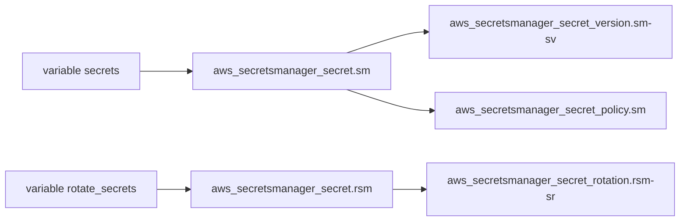

# lgallard/terraform-aws-secrets-manager

> Terraform module to create AWS Secrets Manager secrets with input validation, for infra teams.

## The problem
Declaring secrets, their rotation, their KMS encryption and their multi-region replication by hand is slow and prone to configuration errors.

## What it actually does
A module that creates text, key/value or binary secrets, with Lambda rotation, cross-region replication, KMS keys, resource policies and variable validation. An `ephemeral` mode avoids writing the values into the Terraform state. It requires Terraform 1.11 and AWS provider 6.50 at minimum.

## How it is wired


## Trying it
```bash
terraform init
terraform apply
```
```hcl
module "secrets-manager-1" {
  source = "lgallard/secrets-manager/aws"
  secrets = {
    secret-1 = { description = "My secret 1", secret_string = "This is an example" }
  }
}
```

## Cost and gotchas
An AWS account is required; secrets, Lambda rotation and replication are billed. Without the `ephemeral` mode, plaintext values remain in the Terraform state.

## What it is not
It is not a secrets manager: it drives the AWS one. Rotation requires an already existing Lambda. Moving from list to map (version 0.5.0) requires a state migration.

## Alternatives
- GoogleCloudPlatform/terraform-google-secret-manager: the Google Cloud equivalent, if it is cited in the batch.

## For you
Watch: relevant if your MLOps runs on AWS with Terraform, but single maintainer and sensitive values to protect in the state.
