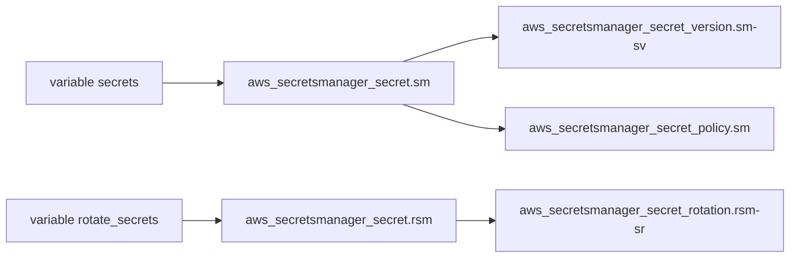

# lgallard/terraform-aws-secrets-manager

> Module Terraform pour créer des secrets AWS Secrets Manager avec validation des entrées, pour équipes infra.

## Le problème
Déclarer à la main des secrets, leur rotation, leur chiffrement KMS et leur réplication multi-régions est long et sujet aux erreurs de configuration.

## Ce que ça fait vraiment
Un module qui crée des secrets texte, clé/valeur ou binaires, avec rotation par Lambda, réplication entre régions, clés KMS, politiques de ressources et validation des variables. Un mode `ephemeral` évite d'écrire les valeurs dans l'état Terraform. Il exige Terraform 1.11 et le fournisseur AWS 6.50 au minimum.

## Comment c'est branché


## Essayer
```bash
terraform init
terraform apply
```
```hcl
module "secrets-manager-1" {
  source = "lgallard/secrets-manager/aws"
  secrets = {
    secret-1 = { description = "My secret 1", secret_string = "This is an example" }
  }
}
```

## Coût et pièges
Compte AWS requis ; les secrets, la rotation Lambda et la réplication sont facturés. Sans le mode `ephemeral`, les valeurs en clair restent dans l'état Terraform.

## Ce que ce n'est pas
Ce n'est pas un gestionnaire de secrets : il pilote celui d'AWS. La rotation exige une Lambda déjà existante. Passer de la liste à la map (version 0.5.0) impose une migration d'état.

## Alternatives
- GoogleCloudPlatform/terraform-google-secret-manager : équivalent côté Google Cloud, s'il est cité dans le lot.

## Pour toi
À surveiller : pertinent si ton MLOps tourne sur AWS avec Terraform, mais mainteneur unique et valeurs sensibles à protéger dans l'état.

