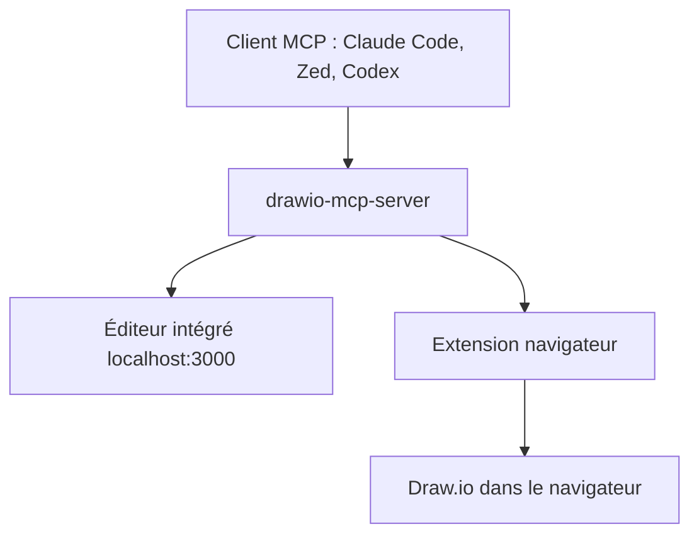

# lgazo/drawio-mcp-server

> MCP server that lets an AI agent create and edit Draw.io diagrams, with a built-in editor.

## The problem
An AI assistant describes an architecture in text but cannot draw or touch up a real Draw.io file.

## What it actually does
The server exposes MCP tools to list documents and pages, add, modify or delete shapes, edges and layers, import Mermaid and export to XML, SVG or PNG. It hosts a Draw.io editor in the browser (`--editor` option) or connects to Draw.io through an extension. Operations are serialized per document, which lets several agents work on separate files.

## How it is wired
Simplified diagram based on the sheet, no diagram provided.



## Trying it
```bash
npx drawio-mcp-server install claude-code
# ou dans Claude Code :
# /plugin marketplace add lgazo/drawio-mcp-server
# /plugin install drawio
```
Then open http://localhost:3000/.

## Cost and gotchas
Free, Node 22 or later. Integration with the Draw.io desktop app is blocked by an upstream CSP policy. Firefox requires TLS mode.

## What it is not
Not a standalone diagram generator: you need an MCP client and a model driving the tools. Desktop support is experimental.

## Alternatives
No alternative named in the README.

## For you
Worth watching: handy for having Claude Code draw architecture diagrams, with no critical dependency, so test it when the need arises.
