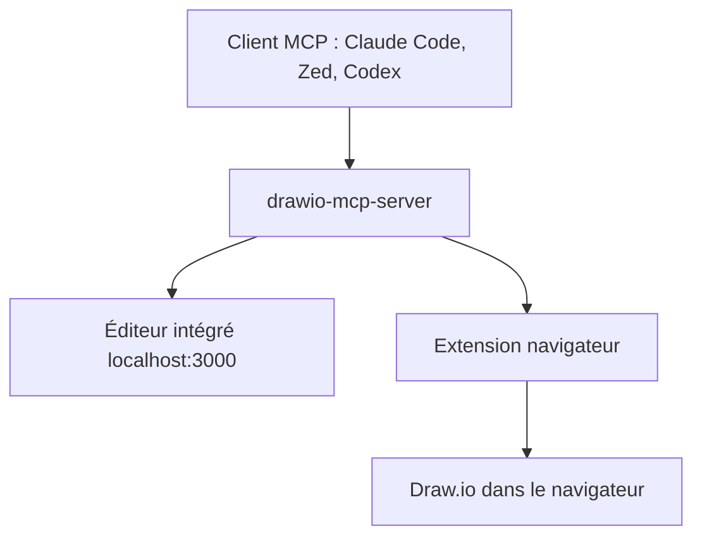

# lgazo/drawio-mcp-server

> Serveur MCP qui laisse un agent IA créer et modifier des diagrammes Draw.io, avec éditeur intégré.

## Le problème
Un assistant IA décrit une architecture en texte mais ne sait pas dessiner ni retoucher un vrai fichier Draw.io.

## Ce que ça fait vraiment
Le serveur expose des outils MCP pour lister les documents et les pages, ajouter, modifier ou supprimer des formes, des arêtes et des calques, importer du Mermaid et exporter en XML, SVG ou PNG. Il héberge un éditeur Draw.io dans le navigateur (option `--editor`) ou se branche sur Draw.io via une extension. Les opérations sont sérialisées par document, ce qui permet à plusieurs agents de travailler sur des fichiers distincts.

## Comment c'est branché
Schéma simplifié d'après la fiche, sans diagramme fourni.



## Essayer
```bash
npx drawio-mcp-server install claude-code
# ou dans Claude Code :
# /plugin marketplace add lgazo/drawio-mcp-server
# /plugin install drawio
```
Puis ouvrir http://localhost:3000/.

## Coût et pièges
Gratuit, Node 22 ou plus. L'intégration à l'application de bureau Draw.io est bloquée par une politique CSP en amont. Firefox demande le mode TLS.

## Ce que ce n'est pas
Pas un générateur de diagrammes autonome : il faut un client MCP et un modèle qui pilote les outils. Le support de bureau est expérimental.

## Alternatives
Aucune alternative nommée dans le README.

## Pour toi
À surveiller : pratique pour faire dessiner des schémas d'architecture par Claude Code, sans dépendance critique, donc à tester quand le besoin se présente.

