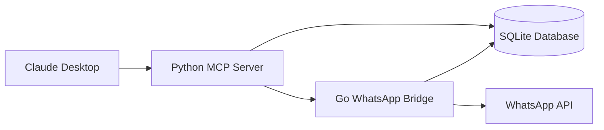

# lharries/whatsapp-mcp

> MCP server that gives Claude or Cursor read/write access to your personal WhatsApp.

## The problem
An LLM agent can neither search your WhatsApp conversations nor send messages in them: everything stays locked inside the mobile app.

## What it actually does
A Go bridge (whatsmeow library, multi-device web API) authenticates by QR code and copies the history into SQLite.
A Python MCP server exposes about a dozen tools: contact search, listing of messages and chats, message context.
Sending of messages, files and voice messages (.ogg Opus conversion via FFmpeg, optional).
Media are only metadata until `download_media` is called.

## How it is wired


## Trying it
```bash
git clone https://github.com/lharries/whatsapp-mcp.git
cd whatsapp-mcp
cd whatsapp-bridge
go run main.go
```
Then declare `uv --directory …/whatsapp-mcp-server run main.py` in `claude_desktop_config.json` or `~/.cursor/mcp.json`.

## Cost and gotchas
Go, Python, uv and an MCP client required; re-authentication about every 20 days. On Windows, CGO and a C compiler are mandatory.

## What it is not
Not an official WhatsApp API: it is your personal account driven by an unofficial client. The README itself warns about the "lethal trifecta": a prompt injection can exfiltrate your private messages.

## Alternatives
No alternative named in the README.

## For you
Worth watching only: a nice example of an MCP bridge + local database architecture, but plugging an LLM into your private messaging without a guardrail against injection is a risk few professional contexts justify.
