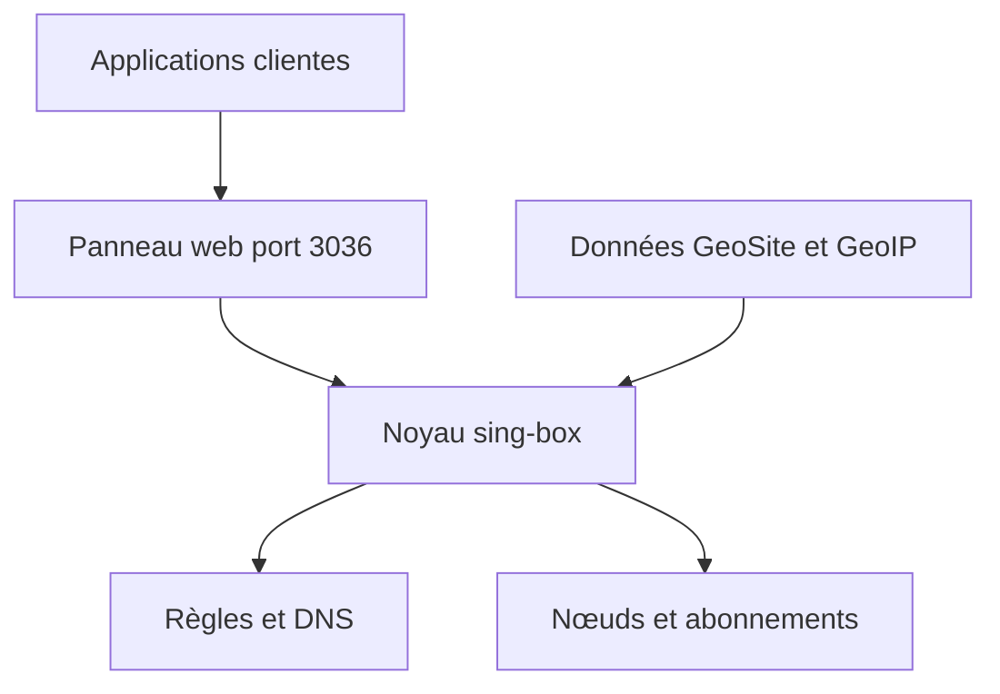

# liandu2024/Open-Box

> All-in-one transparent proxy for OpenWrt routers, Debian or Docker, with mobile and desktop clients.

## The problem
Writing proxy, DNS and firewall configurations by hand to route local network traffic is tedious.

## What it actually does
A package installs Open-Box, a sing-box core, Node and the GeoSite and GeoIP data, then a web panel manages subscriptions, nodes, routing rules, DNS and firewall. Android, macOS, Windows and Linux apps reuse the same rules away from home after pairing by code. Repository written in Chinese.

## How it is wired
Simplified diagram based on the fiche, no diagram provided.



## Trying it
```bash
curl -fsSL https://raw.githubusercontent.com/liandu2024/Open-Box/main/scripts/install.sh | sh
curl -fsSL https://raw.githubusercontent.com/liandu2024/Open-Box/main/scripts/update.sh | sh
curl -fsSL https://raw.githubusercontent.com/liandu2024/Open-Box/main/scripts/uninstall.sh | sh
```

## Cost and gotchas
Free, but the program is declared closed and proprietary: redistribution and reverse engineering forbidden. At least 512 MB of storage and memory. The panel runs over HTTP with root rights: do not expose it to the internet. Scripts to be run via `curl | sh`.

## What it is not
Not an open project despite its name: only the scripts, docs and releases are public. Does not settle the choice of node providers.

## Alternatives
No alternative named in the README; the cited video compares it to OpenClash, Nikki and Passwall.

## For you
Ignore: closed network-routing tool, installed by root script, unrelated to a data/AI/MLOps profile.
