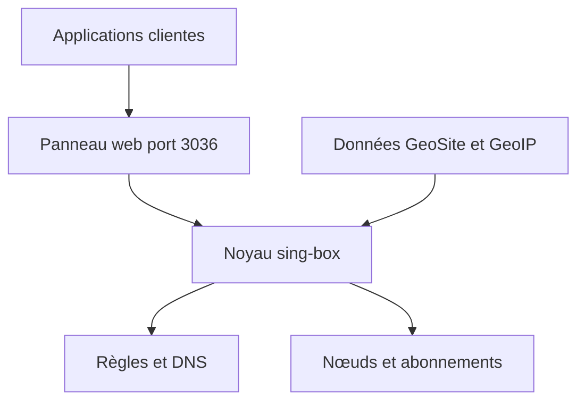

# liandu2024/Open-Box

> Proxy transparent tout-en-un pour routeur OpenWrt, Debian ou Docker, avec clients mobiles et bureau.

## Le problème
Écrire à la main des configurations de proxy, DNS et pare-feu pour router le trafic du réseau local est fastidieux.

## Ce que ça fait vraiment
Un paquet installe Open-Box, un noyau sing-box, Node et les données GeoSite et GeoIP, puis un panneau web gère abonnements, nœuds, règles de routage, DNS et pare-feu. Des applications Android, macOS, Windows et Linux reprennent les mêmes règles hors du domicile après appairage par code. Dépôt rédigé en chinois.

## Comment c'est branché
Schéma simplifié d'après la fiche, sans diagramme fourni.



## Essayer
```bash
curl -fsSL https://raw.githubusercontent.com/liandu2024/Open-Box/main/scripts/install.sh | sh
curl -fsSL https://raw.githubusercontent.com/liandu2024/Open-Box/main/scripts/update.sh | sh
curl -fsSL https://raw.githubusercontent.com/liandu2024/Open-Box/main/scripts/uninstall.sh | sh
```

## Coût et pièges
Gratuit, mais le programme est annoncé fermé et propriétaire : redistribution et rétro-ingénierie interdites. Au moins 512 Mo de stockage et de mémoire. Le panneau roule en HTTP avec droits root : ne pas l'exposer sur internet. Scripts à lancer par `curl | sh`.

## Ce que ce n'est pas
Pas un projet ouvert malgré son nom : seules les scripts, docs et publications sont publics. Ne règle pas le choix des fournisseurs de nœuds.

## Alternatives
Aucune alternative nommée dans le README ; la vidéo citée compare à OpenClash, Nikki et Passwall.

## Pour toi
À ignorer : outil de routage réseau fermé, installé par script root, sans lien avec un profil data/IA/MLOps.

