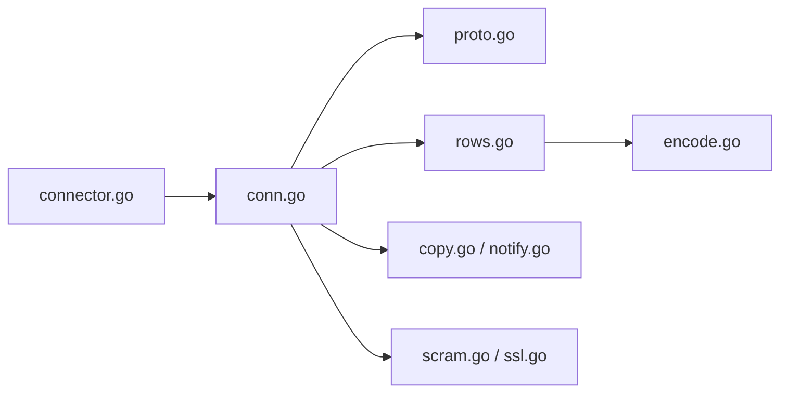

# lib/pq

> PostgreSQL driver in Go for `database/sql`.

## The problem
A Go program needs to talk to PostgreSQL through the standard interface.

## What it actually does
Implements the PostgreSQL protocol: libpq-compatible DSN (and runtime parameters such as `search_path`), password, MD5, SCRAM-SHA256 authentication, Kerberos in a separate module, TLS, `COPY ... FROM STDIN`, `LISTEN/NOTIFY`, arrays and hstore, typed `pq.Error` errors. Protocol debugging with `PQGO_DEBUG=1`.

## How it is wired


## Trying it
```go
db, err := sql.Open("postgres", "host=localhost dbname=pqgo connect_timeout=5")
err = db.Ping()
```
```bash
docker compose up -d
```

## Cost and gotchas
Free. Add `connect_timeout` (otherwise it waits forever). `LastInsertId` is not supported: use `RETURNING`. `timestamp` values without a time zone get an empty fixed zone, not UTC. License not identified by GitHub.

## What it is not
Not an ORM. The README cites no alternative; the license file needs to be reread.

## Alternatives
No alternative named in the README.

## For you
Adopt in Go for PostgreSQL (pipelines, data services): maintained in 2026, but read the LICENSE file before integrating it.
