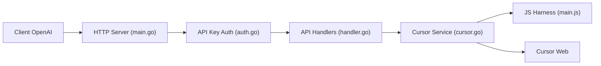

# libaxuan/cursor2api-go

> Go service that exposes Cursor Web as an OpenAI chat/completions-compatible API.

## The problem
Using the models available through Cursor from any OpenAI-compatible client, without an official API.

## What it actually does
Receives chat requests, translates them into calls to Cursor Web, then returns the parsed events, streamed or not. Handles API key, tools (tool_calls), derived "-thinking" variants and a health endpoint. A JavaScript harness under Node.js reproduces the browser environment. Documented model: gemini-3-flash.

## How it is wired


## Trying it
```bash
git clone https://github.com/libaxuan/cursor2api-go.git
cd cursor2api-go
./start.sh
curl -H "Authorization: Bearer 0000" http://localhost:8002/v1/models
```

## Cost and gotchas
Free, but relies on a Cursor account and on bypassing protections (x-is-human token, browser fingerprint). Default key "0000". README in Chinese; 403 errors and Cloudflare are mentioned.

## What it is not
Not an official API: it can break at any time and violate the terms of use (the README itself says to respect them). The README announces PolyForm Noncommercial, commercial use forbidden, while GitHub does not recognize the license.

## Alternatives
No alternative named in the README.

## For you
Ignore: hijacking a third-party service, non-commercial license and risk of breakage; go through an official API.
