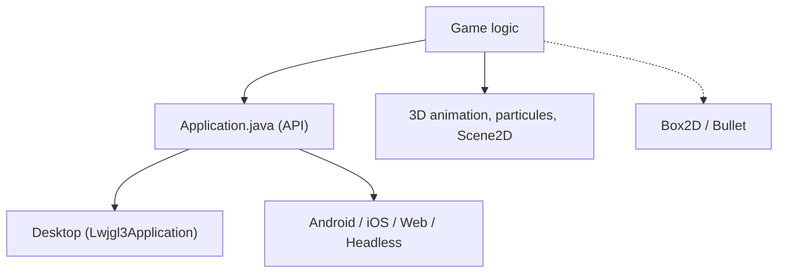

# libgdx/libgdx

> Cross-platform Java framework for building 2D and 3D games on desktop, Android, iOS, and the web.

## The problem
Writing a game for several platforms means rewriting rendering, input, audio, and files for each one.

## What it actually does
Provides a common API (Application) implemented by one backend per platform: desktop, Android, iOS, web (GWT), and headless. Adds 3D animation, particles, a Scene2D interface, and physics through the Box2D and Bullet extensions. Based on OpenGL (ES), without imposing a coding style.

## How it is wired

## Trying it
No command in the README: it points to the website, the wiki, and a Gradle-based project creation tool.

## Cost and gotchas
Free, Apache-2.0 license. Requires Java and Gradle, not listed among the plan's prerequisites. iOS and web builds go through separate backends.

## What it is not
Not a game engine with a graphical editor: it is a code framework. Not designed for data or AI.

## Alternatives
- awesome-libgdx: a list of tools and libraries around libGDX, cited in the README.

## For you
Ignore: a Java game framework, outside the data, AI, or MLOps scope.
