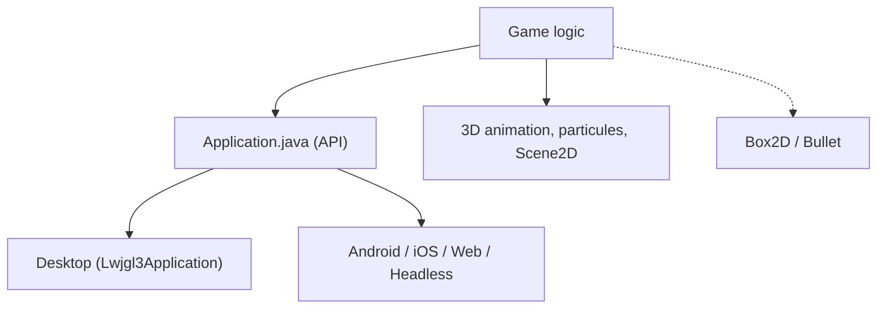

# libgdx/libgdx

> Framework Java multiplateforme pour créer des jeux 2D et 3D sur desktop, Android, iOS et web.

## Le problème
Écrire un jeu pour plusieurs plateformes oblige à réécrire rendu, entrées, audio et fichiers pour chacune.

## Ce que ça fait vraiment
Fournit une API commune (Application) implémentée par un backend par plateforme : desktop, Android, iOS, web (GWT) et headless. Ajoute de l'animation 3D, des particules, une interface Scene2D, et la physique via les extensions Box2D et Bullet. Basé sur OpenGL (ES), sans imposer de style de code.

## Comment c'est branché

## Essayer
Aucune commande dans le README : il renvoie au site, au wiki et à un outil de création de projet basé sur Gradle.

## Coût et pièges
Gratuit, licence Apache-2.0. Demande Java et Gradle, non listés parmi les prérequis du plan. Les builds iOS et web passent par des backends distincts.

## Ce que ce n'est pas
Pas un moteur de jeu avec éditeur graphique : c'est un framework de code. Pas conçu pour la data ni l'IA.

## Alternatives
- awesome-libgdx : liste d'outils et bibliothèques autour de libGDX, citée dans le README.

## Pour toi
À ignorer : un framework de jeu en Java, hors du périmètre data, IA ou MLOps.

