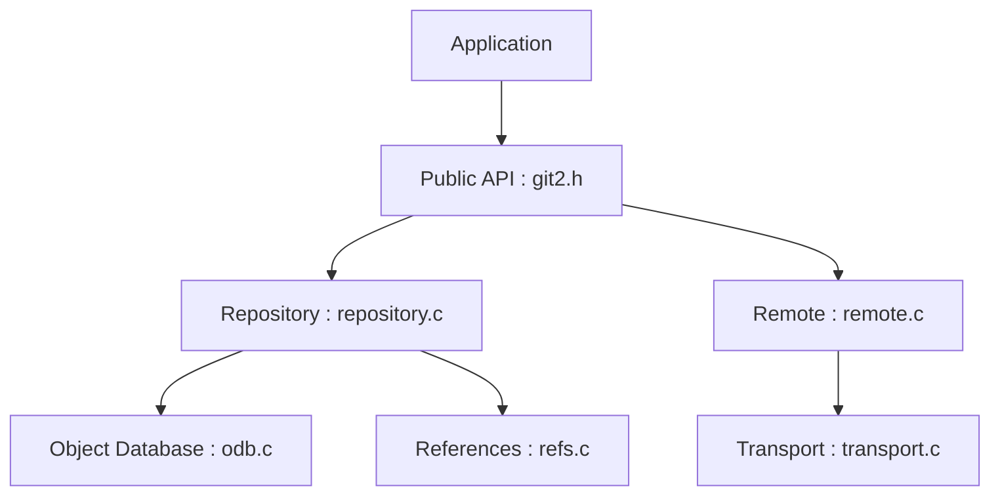

# libgit2/libgit2

> Portable C library of core Git functions, to embed Git in an application.

## The problem
Calling the git command line from a program is fragile; a stable API is needed to read and write repositories.

## What it actually does
It exposes more than 175 calls: objects, index, references, configuration, history traversal, diff, merge, checkout, status and remote operations. Bindings exist for many languages, including Python (pygit2) and Rust (git2-rs). It is used by GitHub.com, Plastic SCM and Azure DevOps.

## How it is wired


## Trying it
```bash
mkdir build && cd build
cmake ..
cmake --build .
ctest -V
```

## Cost and gotchas
Free. Requires CMake, Python for the tests and a C compiler. GPLv2 license with linking exception, not identified by GitHub: to be verified. The API is not promised to be stable.

## What it is not
It is not a replacement for the git command: most user commands are out of scope. It can also lag behind changes in Git.

## Alternatives
No alternative named, apart from bindings such as pygit2.

## For you
Worth watching: useful in Python via pygit2 to automate Git operations in MLOps tools, with no direct use in C.
