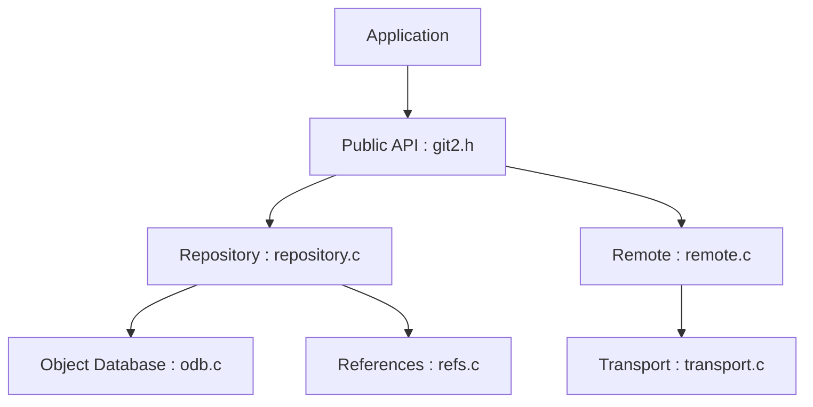

# libgit2/libgit2

> Bibliothèque C portable des fonctions de base de Git, pour intégrer Git dans une application.

## Le problème
Appeler la ligne de commande git depuis un programme est fragile ; il faut une API stable pour lire et écrire des dépôts.

## Ce que ça fait vraiment
Elle expose plus de 175 appels : objets, index, références, configuration, parcours de l'historique, diff, fusion, checkout, statut et opérations distantes. Des liaisons existent pour de nombreux langages, dont Python (pygit2) et Rust (git2-rs). Elle sert à GitHub.com, Plastic SCM et Azure DevOps.

## Comment c'est branché


## Essayer
```bash
mkdir build && cd build
cmake ..
cmake --build .
ctest -V
```

## Coût et pièges
Gratuit. Il faut CMake, Python pour les tests et un compilateur C. Licence GPLv2 avec exception de liaison, non identifiée par GitHub : à vérifier. L'API n'est pas promise stable.

## Ce que ce n'est pas
Ce n'est pas un remplaçant de la commande git : la plupart des commandes d'utilisateur sont hors périmètre. Elle peut aussi retarder sur les changements de Git.

## Alternatives
Aucune alternative nommée, hors liaisons comme pygit2.

## Pour toi
Surveiller : utile en Python via pygit2 pour automatiser des opérations Git dans des outils MLOps, sans usage direct en C.

