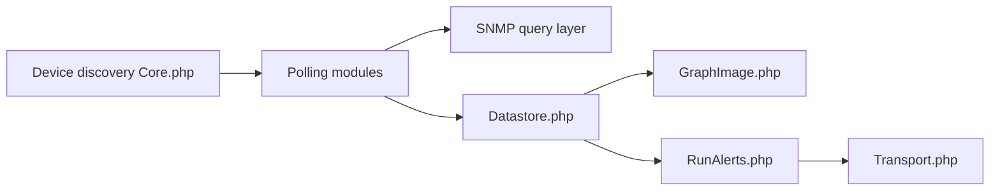

# librenms/librenms

> Auto-discovering network monitoring in PHP/MySQL/SNMP for network administrators.

## The problem
Monitoring a heterogeneous fleet (Cisco, Juniper, Linux...) without configuring each device by hand.

## What it actually does
Discovers devices, polls them over SNMP through per-OS drivers and polling modules, stores time series (RRD), draws graphs, evaluates alert rules and sends them through notification transports. Web interface, authentication, legacy API. The README points to the docs for installation; a VirtualBox VM image is offered.

## How it is wired

## Trying it
No command documented in the README: installation is described on docs.librenms.org, or download the VirtualBox VM image.

## Cost and gotchas
Free; PHP + MySQL server and SNMP enabled on the devices. License: GPLv3 with a linking exception, but not recognized by GitHub.

## What it is not
Not an application or ML monitoring tool; centered on the network.

## Alternatives
No alternative named in the README.

## For you
Worth watching: useful only if you operate a physical network; little connected to a data/AI profile.
