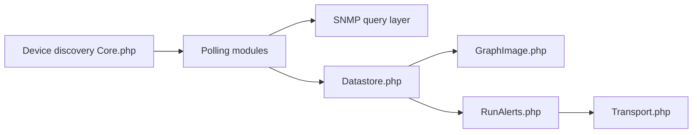

# librenms/librenms

> Supervision réseau auto-découvrante en PHP/MySQL/SNMP pour administrateurs réseau.

## Le problème
Superviser un parc hétérogène (Cisco, Juniper, Linux…) sans configurer chaque équipement à la main.

## Ce que ça fait vraiment
Découvre les équipements, les interroge en SNMP via des pilotes par OS et modules de polling, stocke les séries temporelles (RRD), trace des graphes, évalue des règles d'alerte et les envoie via des transports de notification. Interface web, authentification, API legacy. Le README renvoie à la doc pour l'installation ; une image VM VirtualBox est proposée.

## Comment c'est branché

## Essayer
Aucune commande documentée dans le README : installation décrite sur docs.librenms.org, ou télécharger l'image VM VirtualBox.

## Coût et pièges
Gratuit ; serveur PHP + MySQL et SNMP activé sur les équipements. Licence : GPLv3 avec exception de liaison, mais non reconnue par GitHub.

## Ce que ce n'est pas
Pas un outil de monitoring applicatif ou ML ; centré sur le réseau.

## Alternatives
Aucune alternative nommée dans le README.

## Pour toi
À surveiller : utile seulement si tu opères un réseau physique ; peu lié à un profil data/IA.

