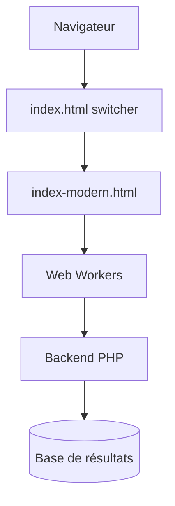

# librespeed/speedtest

> Lightweight, self-hostable JavaScript speed test to measure your connection without Flash or Java.

## The problem
Public speed tests are third-party and heavy; you need a test running on your own server.

## What it actually does
Measures download, upload, ping and jitter (XMLHttpRequest + Web Workers), with optional IP/ISP lookup, optional telemetry and sharing, and multiple test points. A stability test (latency graph, CSV export). PHP backend, also Go and Rust; Docker image updated every week.

## How it is wired


## Trying it
```bash
# copier le dépôt dans /var/www/html/speedtest puis ouvrir YOURSITE/speedtest/index.html
# Docker : image GitHub (voir la doc Docker)
```

## Cost and gotchas
Web server + PHP 5.4+; MySQL/MariaDB database optional; fast bandwidth needed.

## What it is not
Only measures the link to your server, not the Internet in general. Telemetry to be disabled as needed.

## Alternatives
speedtest-go, speedtest-rust (backends cited).

## For you
Worth watching: useful for diagnosing the network of a cluster or a site, outside the core of MLOps.
