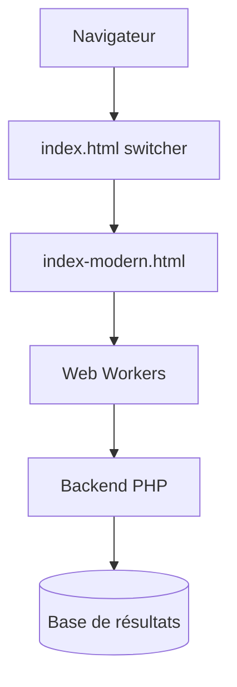

# librespeed/speedtest

> Test de débit léger en JavaScript, auto-hébergeable, pour mesurer sa connexion sans Flash ni Java.

## Le problème
Les tests de débit publics sont tiers et chargés ; il faut un test sur son propre serveur.

## Ce que ça fait vraiment
Mesure téléchargement, envoi, ping, gigue (XMLHttpRequest + Web Workers), IP/FAI optionnels, télémétrie et partage optionnels, points de test multiples. Un test de stabilité (graphe de latence, export CSV). Backend PHP, également Go, Rust ; image Docker mise à jour chaque semaine.

## Comment c'est branché


## Essayer
```bash
# copier le dépôt dans /var/www/html/speedtest puis ouvrir YOURSITE/speedtest/index.html
# Docker : image GitHub (voir la doc Docker)
```

## Coût et pièges
Serveur web + PHP 5.4+ ; base MySQL/MariaDB optionnelle ; bande passante rapide nécessaire.

## Ce que ce n'est pas
Ne mesure que le lien vers ton serveur, pas Internet en général. Télémétrie à désactiver selon besoin.

## Alternatives
speedtest-go, speedtest-rust (backends cités).

## Pour toi
Surveiller : utile pour diagnostiquer le réseau d'un cluster ou d'un site, hors cœur MLOps.

