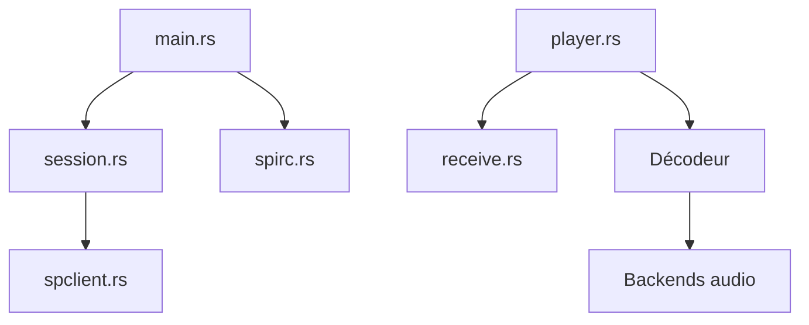

# librespot-org/librespot

> Rust client library for Spotify, with a headless Spotify Connect receiver, for Premium accounts.

## The problem
There is no longer an official open library for playing Spotify music from your own devices.

## What it actually does
Opens a Spotify session, accepts Connect control, fetches and decrypts the audio, decodes it, then sends it to an output backend (Rodio, ALSA, PulseAudio, JACK and others). Handles discovery, credential caching and playback events. A headless receiver example is provided.

## How it is wired


## Trying it
```bash
cargo install librespot
librespot -n "Librespot Speaker" -b 160
cargo build --release
target/release/librespot --name DEVICENAME
```

## Cost and gotchas
Spotify Premium required. Recent accounts fail ("audio key error 0 1"), with no known workaround. Protect the credential cache (permissions 700).

## What it is not
Not a standalone service, and not always working. The README warns that its use is probably forbidden by Spotify.

## Alternatives
- Spotifyd: lightweight UNIX daemon.
- raspotify: turnkey Spotify Connect client.
- ncspot: terminal client.

## For you
Ignore: off-topic for data/AI, contractual risk and a known block on recent accounts.
