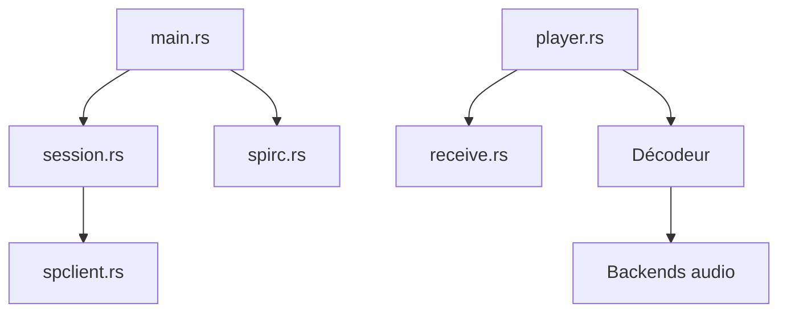

# librespot-org/librespot

> Bibliothèque Rust cliente de Spotify, avec récepteur Spotify Connect sans écran, pour comptes Premium.

## Le problème
Il n'existe plus de bibliothèque officielle ouverte pour jouer de la musique Spotify depuis ses propres appareils.

## Ce que ça fait vraiment
Ouvre une session Spotify, accepte le contrôle Connect, récupère et déchiffre l'audio, le décode puis l'envoie vers un backend de sortie (Rodio, ALSA, PulseAudio, JACK et autres). Gère découverte, cache d'identifiants et événements de lecture. Un exemple de récepteur sans écran est fourni.

## Comment c'est branché


## Essayer
```bash
cargo install librespot
librespot -n "Librespot Speaker" -b 160
cargo build --release
target/release/librespot --name DEVICENAME
```

## Coût et pièges
Spotify Premium obligatoire. Les comptes récents échouent (« audio key error 0 1 »), sans contournement connu. Cache d'identifiants à protéger (permissions 700).

## Ce que ce n'est pas
Pas un service autonome ni toujours fonctionnel. Le README avertit que son usage est probablement interdit par Spotify.

## Alternatives
- Spotifyd : démon UNIX allégé.
- raspotify : client Spotify Connect clé en main.
- ncspot : client terminal.

## Pour toi
À ignorer : hors sujet data/IA, risque contractuel et blocage connu sur les comptes récents.

